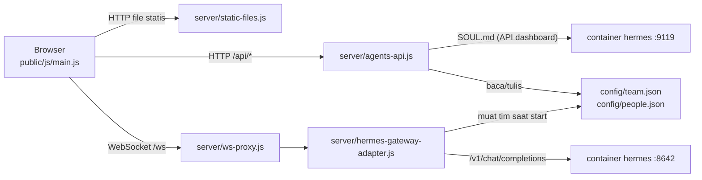

# Arsitektur Agentic Digital Office

Panduan singkat untuk developer yang baru bergabung: apa saja bagiannya, bagaimana data mengalir, dan file mana yang diubah untuk tugas tertentu. Cara instalasi dan pemakaian ada di [PANDUAN.md](PANDUAN.md).

## Gambaran besar

Dua container Docker (lihat `docker-compose.yml`):

- **`hermes`**: image resmi Hermes Agent. Menyediakan API mirip OpenAI di port 8642 dan dashboard di port 9119. Data (API key, SOUL.md, memori, skill) disimpan di volume Docker.
- **`office`**: image yang kita bangun dari folder `office/`. Satu proses Node yang menyajikan UI kantor 3D, API panel agen, dan adapter yang menerjemahkan protokol kantor ke API Hermes.



## Peta folder

```
config/                 data agen (di-mount ke container office, bisa ditulis)
  team.json             daftar agen + persona (nama, peran, instruksi, batasan)
  people.json           tampilan + suara per agen (rambut, warna, kostum, voice)
  layout.json           posisi furnitur dari 🛠 Layout (belum ada = defaultLayout() di furniture.js)
docs/                   PANDUAN.md (pemakaian), ARCHITECTURE.md (dokumen ini)
office/                 image Docker "office"
  Dockerfile, package.json
  server/               sisi server (Node, CommonJS)
    index.js            titik masuk: routing HTTP + memasang proxy WebSocket
    static-files.js     file UI, three.js dari node_modules, streaming MP3
    ws-proxy.js         meneruskan /ws ke adapter (127.0.0.1)
    agents-api.js       REST panel ⚙ Agen + SOUL.md lewat dashboard Hermes
    projects.js         daftar proyek di /workspace + proyek aktif (config/office.json)
    hermes-gateway-adapter.js   adapter dari Claw3D (MIT): tim, chat, orkestrasi
    summaries.js        log ringkasan jawaban (panel 📋 RINGKASAN), disimpan di office-data
    meetings.js         rapat tim: giliran bicara peserta + notulen Hermes (panel 💬 Rapat)
    layout-api.js       GET/PUT/DELETE /api/layout: baca, simpan, dan reset config/layout.json
    usage.js            catatan token per hari/agen/model, laporan harian-mingguan-bulanan (panel 📊 Pemakaian), disimpan di office-data
  public/               sisi browser (ES modules, tanpa build step)
    index.html, style.css
    audio/              MP3 pribadi (tidak masuk git, lihat audio/README.md)
    js/
      main.js           titik masuk UI: menyambungkan semua modul + state aplikasi
      net/gateway.js    klien WebSocket ke adapter (request/response + event)
      world/
        world.js        renderer, kamera, cahaya, agen (meja, kegiatan, gerak)
        routing.js      jalur jalan: koridor, lorong samping, pintu ruangan
      office/           scene kantor
        layout.js       DENAH: ukuran kantor, ruangan, dinding, pintu (ACTIVITY_SPOTS dan MEETING.seats diisi furniture.js)
        index.js        merakit seluruh scene (buildOffice)
        rooms.js        dinding kaca, pintu, papan nama
        furniture.js    furnitur yang bisa dipindah: katalog, layout bawaan, aturan penempatan, manajer
        decor.js        hiasan dinding (whiteboard, neon, jam)
        props.js        meja, kursi, lampu, pohon, rak server, ...
        textures.js     tekstur pixel-art (rumput, lantai per ruangan, papan nama)
        helpers.js      material, box/cone, tekstur canvas, random ber-seed
      characters/       karakter voxel
        person.js       membuat karakter dari data tampilan
        head.js         wajah pixel + gaya rambut
        costumes.js     kostum (tema Pokémon, Digimon, anime)
        animation.js    pose per frame (jalan, duduk, rapat, main, ...)
        presets.js      tampilan bawaan
        parts.js        potongan dasar (box, cone, material)
      ui/
        name-tags.js    label nama + gelembung kata (DOM)
        agents-panel.js panel ⚙ Agen (tambah/ubah/hapus agen, SOUL.md, 🧰 Tools)
        projects.js     dropdown 📁 Proyek (proyek yang dikerjakan agen)
        approvals.js    panel PERSETUJUAN (izin perintah berisiko dari Hermes)
        summaries.js    panel 📋 RINGKASAN di kiri (jawaban yang sudah selesai)
        meeting.js      panel 💬 Rapat (form, transkrip langsung, notulen, unduh .md)
        usage.js        panel 📊 Pemakaian (tab harian/mingguan/bulanan, kartu per agen)
        layout-editor.js  mode 🛠 Layout: pilih, seret, putar, tambah, hapus, urungkan, simpan
        jukebox.js      musik latar (playlist, ulang, sisa waktu)
        voice.js        suara agen (Web Speech API)
```

## Alur saat Anda mengirim pesan ke agen

1. `main.js` mengirim `chat.send` lewat `net/gateway.js`.
2. `ws-proxy.js` meneruskannya ke adapter. Adapter memilih persona agen dari `config/team.json` dan memanggil API Hermes.
3. Jawaban kembali sebagai event `chat` (`delta` lalu `final`), di-broadcast ke semua tab. Pesan pengguna langsung disimpan ke riwayat (`clawd3d-history.json`), balasan disimpan saat selesai (balasan gagal diberi `error: true` dan tidak ikut dikirim ke model). Setiap balasan selesai juga dicatat di `office-summaries.json` dan dikirim sebagai event `summary`. Tab yang baru dibuka memanggil `chat.active`, `chat.history`, dan `summaries.list`.
4. `main.js` memperbarui status agen di `World` (jalan ke meja dan mengetik), menampilkan gelembung kata (`ui/name-tags.js`), membacakan balasan (`ui/voice.js`), dan mencatat ke Aktivitas Terbaru.

## Proyek

`PROJECTS_DIR` dari `.env` di-mount ke kedua container sebagai `/workspace`: baca-tulis di `hermes` (tempat tools agen berjalan), hanya-baca di `office` (untuk daftar proyek). Proyek aktif disimpan di `config/office.json` (tidak di-commit). `server/projects.js` meneruskannya ke adapter lewat `team.setProject()`, lalu adapter menambahkan folder proyek dan aturan branch git ke prompt sistem setiap agen (`withProjectContext` di `hermes-gateway-adapter.js`).

## Tools Hermes

Tools (terminal, file, web, browser, memori, skill, ...) dijalankan oleh Hermes sendiri di container `hermes`, bukan oleh kantor. Saat streaming `/v1/chat/completions`, Hermes mengirim event SSE bernama di samping chunk OpenAI biasa:

- `hermes.tool.progress` (`running` / `completed`): `streamOneTurn` di adapter meneruskannya sebagai event `tool` `{ agentId, tool, emoji, label, status }`. `main.js` menampilkan ikonnya di label nama (`NameTags.setTool`) dan mencatatnya di Aktivitas Terbaru.
- `approval.request`: adapter menyimpannya di `pendingApprovals` dan meneruskannya sebagai event `approval`. `ui/approvals.js` menampilkan tombol pilihan; jawabannya lewat metode `exec.approval.resolve`, yang diteruskan adapter ke `POST /v1/runs/{run_id}/approval` `{ choice, request_id }`. Tab baru mengambil yang masih menunggu lewat `exec.approvals.pending`.

Tab 🧰 Tools di panel ⚙ Agen memakai metode `tools.catalog` (adapter memanggil `GET /v1/toolsets`). Daftarnya hanya-baca, karena konfigurasi toolset diatur di dashboard Hermes.

## Rapat tim

`meeting.start` (`server/meetings.js`) menjalankan giliran secara berurutan: pembukaan Hermes, peserta × putaran, lalu notulen Hermes. Setiap giliran adalah satu `streamOneTurn` dengan prompt persona + aturan rapat + transkrip sejauh ini, dengan batas diam 90 detik. Event `meeting` (`started`, `speaking`, `delta`, `turn`, `ended`, `stopped`, `error`) menggerakkan `ui/meeting.js` dan `World.startMeeting()` / `endMeeting()`; posisi kursi dan whiteboard ada di `MEETING` (`office/layout.js`). Notulen dicatat lewat `recordSummary` (jenis `meeting`) dan ditambahkan ke riwayat setiap peserta.

## Model per agen dan pemakaian token

**Model per agen.** `team.json` boleh punya `model` per anggota; `registerTeamMember` menaruhnya di `settings.model`, dan `chat.send`, delegasi, serta rapat memakainya (kosong = `HERMES_MODEL`, alias `hermes-agent` yang berarti model default Hermes). Agar model itu benar-benar dipakai ada dua syarat:

- Hermes harus menerima model dari klien: `platforms.api_server.extra.direct_model_requests: true` di config Hermes (diatur dengan `hermes config set`, tersimpan di volume `hermes-data`, bukan di git). Tanpa itu Hermes memakai model default.
- `resolveHermesModel` di adapter hanya me-resolve alias `hermes-agent`. Id model lain (mis. `anthropic/claude-haiku-4.5`, atau `provider::model` untuk provider non-default) diteruskan apa adanya. Awalan provider tidak boleh dipotong.

Dropdown di `ui/agents-panel.js` mengambil daftarnya dari `GET /api/models` (`agents-api.js`), yang meneruskan `/api/model/options` dari dashboard Hermes (login cookie yang sama dengan SOUL.md), dikelompokkan per provider, di-cache 5 menit. Model provider non-default diberi nilai `slug::id`. Kalau dashboard tidak terjangkau, endpoint mengembalikan `groups: []` dan `error`, dan form tetap bisa dipakai lewat "Ketik model lain".

**Pemakaian token.** Hermes mengirim `usage` (`prompt_tokens`, `completion_tokens`) di chunk terakhir stream (dan di body non-stream). `streamOneTurn` dan `completeOneTurn` mengembalikannya bersama model yang dipakai (jalur fallback menjumlahkan keduanya). `recordUsage(agentId, hasil)` dipanggil di tiga tempat: loop chat (`runAgenticLoop`), delegasi (`execDelegateTask`), dan rapat (`meetings.js` lewat dependensi `recordUsage`). Alias `hermes-agent` diganti nama model aslinya dari `GET /api/model/info` di dashboard (cache 60 detik).

`server/usage.js` menyimpan hitungan per hari: `{ "YYYY-MM-DD": { agentId: { model: { calls, input, output } } } }` di `office-usage.json` (disimpan dengan jeda 500 ms, 400 hari terakhir). `report(range)` mengelompokkan hari menjadi 7 hari, 8 minggu (mulai Senin), atau 6 bulan, dihitung dengan zona waktu `OFFICE_TZ` (bawaan `Asia/Jakarta`). `GET /api/usage?range=daily|weekly|monthly` di `index.js` mengembalikan `{ periods, total, agents: { id: { total, models, series } } }`, yang dirender `ui/usage.js` (polling 15 detik selama panel terbuka). Biaya tidak dihitung karena Hermes tidak mengirim harga per balasan.

## Furnitur dan editor layout

Furnitur adalah data, bukan kode: daftar `{ id, type, x, z, rot, variant? }` (`x`/`z` = pusat jejak dalam tile, `rot` = putaran 90° 0 sampai 3). `defaultLayout()` di `office/furniture.js` membuat tata letak bawaan; kalau ada `config/layout.json`, `main.js` memuatnya lebih dulu lewat `GET /api/layout` (`loadLayout()`) dan meneruskannya ke `World` → `buildOffice(scene, layout)`.

**Katalog (`CATALOG`).** Tiap jenis punya `build()` (Group dengan pusat jejak sebagai titik asal, boleh mengisi `userData.tick(t)` untuk animasi seperti uap, ikan, bola, layar arcade), `rects` (potongan jejak untuk tabrakan, dalam koordinat lokal), `spots` (titik berdiri atau duduk agen, relatif terhadap benda), serta `variants`, `max`, dan `floor` (karpet: boleh di bawah benda lain).

**Manajer (`createFurniture`).** Membangun, memindah, dan menghapus benda, serta:

- `canPlace(item)`: di dalam `OFFICE`, tidak menabrak dinding (`WALL_RECTS` dari `ROOMS`), tidak menutup pintu atau lingkaran panggil (`BLOCK_RECTS`), tidak menimpa benda lain, dan menghormati `max`. Mengembalikan `{ ok, reason }`.
- `snap(item, x, z)`: grid 0,1 tile, lalu menempel rata ke tepi lantai, dinding, dan tepi benda lain dalam jarak 0,14 tile.
- `pick(raycaster)`: benda di bawah kursor. `World.groundPoint()` dan `World.pickFurniture()` menyiapkan sinarnya.
- `syncSpots()`: mengisi `ACTIVITY_SPOTS` dan `MEETING.seats` **di tempat** dari `spots` semua benda. Objek titik dipertahankan menurut id (`<id benda>/<id titik>`), jadi agen yang sedang menuju atau memakai titik itu ikut berpindah. Ruang titik dihitung ulang dengan `roomAt()`.
- `setDesks(people)`: agen ke-*i* mendapat meja ke-*i* menurut urutan di daftar (meja pertama = Hermes). Kursi memakai `seat` milik katalog (`desk`), ruangnya dari `roomAt()`. Agen yang lebih banyak daripada meja mendapat meja terbuka otomatis (`makeAutoDesk` di `index.js`), dan papan nama ruang pribadi mengikuti pemilik meja di dalamnya.
- `onChange`: dipanggil setelah perubahan yang final; `World` memakainya untuk `refreshDesks()` sehingga agen yang duduk berjalan ke kursi barunya.

**Editor (`ui/layout-editor.js`).** Penanganan pointer memakai fase *capture* pada kanvas supaya menyeret benda tidak ikut memutar kamera (`OrbitControls`). Saat dipegang, model hanya dipratinjau (`update(id, patch, { preview: true })`); data baru berubah ketika dilepas di tempat yang valid. Jejak hijau/merah/kuning digambar dengan `depthTest: false` agar terlihat di atas benda. Riwayat undo/redo berupa potret JSON seluruh layout (maks. 60). Setiap perubahan disimpan otomatis dengan jeda 500 ms (`PUT /api/layout`); **Kembalikan ke bawaan** memanggil `DELETE`.

**Server (`server/layout-api.js`).** Hanya memeriksa bentuk dan rentang (maks. 300 benda, id unik, posisi -5 sampai 60, rotasi 0 sampai 3); jenis benda divalidasi browser terhadap katalognya. Berkas ditulis atomik ke `config/layout.json` (`LAYOUT_FILE` bisa menggantinya).

Batasan: dinding dan pintu belum bisa diedit, rapat selalu dianggap berlangsung di `rapat` (satu meja rapat), dan routing agen belum menghindari furnitur.

## Siklus hidup agen di World

Setiap agen punya `mode`: `idle` → `wander` atau `toSpot` (berjalan ke properti) → `activity` (memakai properti), atau `toSeat` → `sitting` saat sedang bekerja. Status `working` dari gateway selalu memanggil agen ke mejanya. Jalur dihitung oleh `world/routing.js` lewat koridor dan pintu ruangan.

## Resep tugas umum

| Ingin | Ubah |
| --- | --- |
| Menambah atau memindah ruangan | `ROOMS` di `office/layout.js` (bentuk, dinding, celah pintu, titik pintu, jenis lantai) |
| Menambah ruang pribadi | `WING` di `office/layout.js` (lebar sayap / ukuran ruang); `PRIVATE_OFFICES` dibuat otomatis, `defaultLayout()` di `office/furniture.js` memberi tiap ruang satu meja dan dua lemari, papan nama lewat `setDesks()` |
| Menambah jenis furnitur | Entri baru di `CATALOG` dan `CATALOG_ORDER` (`office/furniture.js`): `build`, `rects` (jejak tabrakan), `spots` bila dipakai agen; tambahkan ke `defaultLayout()` bila perlu ada sejak awal |
| Menambah pose untuk properti | Titik (`spots`) di entri katalognya, pose baru di `characters/animation.js` |
| Menambah kostum | Entri baru di `COSTUMES` (`characters/costumes.js`) + id-nya di daftar `COSTUMES` di `server/agents-api.js` |
| Menambah gaya rambut | `addHair` di `characters/head.js` + pilihan di `ui/agents-panel.js` dan `server/agents-api.js` |
| Menambah lagu | MP3 ke `public/audio/`, entri di `PLAYLIST` (`ui/jukebox.js`) |
| Mengubah API panel agen | `server/agents-api.js` (validasi input ada di sana) |

Setiap perubahan di `office/` perlu `docker compose up -d --build office`, lalu refresh browser.

## Konvensi

- Satu file, satu tanggung jawab. Setiap file diawali komentar singkat yang menjelaskan isinya.
- Browser memakai ES modules dengan import relatif; three.js diimpor sebagai `"three"` lewat import map di `index.html`.
- Server memakai CommonJS (`require`) dan modul bawaan Node, dengan satu dependensi: `ws`.
- Satuan dunia 3D: 1 unit = 1 petak lantai. Sumbu x kiri ke kanan, z belakang ke depan, y ke atas.
- Teks UI berbahasa Indonesia; komentar kode berbahasa Inggris.
- Rahasia hanya di `.env` (tidak pernah di-commit), MP3 pribadi tidak di-commit.
