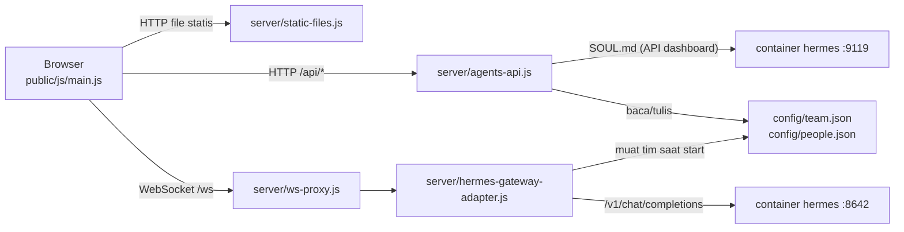

# Arsitektur Agentic Digital Office

Panduan singkat untuk developer yang baru bergabung: apa saja bagiannya, bagaimana data mengalir, dan file mana yang diubah untuk tugas tertentu. Cara instalasi dan pemakaian ada di [PANDUAN.md](PANDUAN.md).

## Gambaran besar

Dua container Docker (lihat `docker-compose.yml`):

- **`hermes`**: image resmi Hermes Agent. Menyediakan API mirip OpenAI di port 8642 dan dashboard di port 9119. Data (API key, SOUL.md, memori, skill) disimpan di volume Docker.
- **`office`**: image yang kita bangun dari folder `office/`. Satu proses Node yang menyajikan UI kantor 3D, API panel agen, dan adapter yang menerjemahkan protokol kantor ke API Hermes.



## Peta folder

```
config/                 data agen (di-mount ke container office, bisa ditulis)
  team.json             daftar agen + persona (nama, peran, instruksi, batasan)
  people.json           tampilan + suara per agen (rambut, warna, kostum, voice)
  layout.json           posisi furnitur dari 🛠 Layout (belum ada = defaultLayout() di furniture.js)
  skills/<nama>/SKILL.md  skill bawaan tim (di-mount ke Hermes di /opt/data/skills/tim; dimuat agen sesuai kebutuhan)
docs/                   PANDUAN.md (pemakaian), ARCHITECTURE.md (dokumen ini)
office/                 image Docker "office"
  Dockerfile, package.json
  server/               sisi server (Node, CommonJS)
    index.js            titik masuk: routing HTTP + memasang proxy WebSocket
    static-files.js     file UI, three.js dari node_modules, streaming MP3
    ws-proxy.js         meneruskan /ws ke adapter (127.0.0.1)
    agents-api.js       REST panel ⚙ Agen + SOUL.md lewat dashboard Hermes
    projects.js         daftar proyek di /workspace + proyek aktif (config/office.json)
    hermes-gateway-adapter.js   adapter dari Claw3D (MIT): tim, chat, orkestrasi
    summaries.js        log ringkasan jawaban (panel 📋 RINGKASAN), disimpan di office-data
    meetings.js         rapat tim: giliran bicara peserta + notulen Hermes (panel 💬 Rapat)
    layout-api.js       GET/PUT/DELETE /api/layout: baca, simpan, dan reset config/layout.json
    team-mcp.js         server MCP office-team: Hermes menugaskan agen kantor (team_delegate, ...)
    hermes-setup.js     mendaftarkan server MCP itu ke Hermes lewat API dashboard
    news.js             GET /api/news: headline Google News Indonesia yang disaring (untuk obrolan agen)
    facts.js            GET /api/facts: kumpulan fakta Wikipedia yang terus bertambah (untuk obrolan agen)
    office-chat.js      POST /api/office-chat: tab Kantor, satu agen menjawab pengguna
    usage.js            catatan token per hari/agen/model, laporan harian-mingguan-bulanan (panel 📊 Pemakaian), disimpan di office-data
  public/               sisi browser (ES modules, tanpa build step)
    index.html, style.css
    audio/              MP3 pribadi (tidak masuk git, lihat audio/README.md)
    js/
      main.js           titik masuk UI: menyambungkan semua modul + state aplikasi
      net/gateway.js    klien WebSocket ke adapter (request/response + event)
      world/
        world.js        renderer, kamera, cahaya, agen (meja, kegiatan, gerak, obrolan antar agen)
        environment.js  langit, waktu (pagi/siang/sore/malam) dan cuaca (hujan, kabut, awan, ...)
        chatter.js      kalimat obrolan antar agen yang santai (tanpa AI)
        routing.js      jalur jalan antar lantai: lobi terbuka, lorong lantai 2 dan 3, pintu ruang, dan lift
      office/           scene kantor
        layout.js       DENAH tiga lantai: bentuk lantai (LEVELS), ruang bertembok dan berpintu (ROOMS), lift (LIFT), gerbang (GATE), titik jalan (WANDER); ACTIVITY_SPOTS dan MEETING.seats diisi furniture.js
        index.js        merakit seluruh scene (buildOffice)
        building.js     cangkang gedung: lantai tiap level, dinding luar dari bentuk denah, menara lift dan kabinnya
        walls.js        potongan dinding (dasar solid + kaca), tiang pintu, railing
        rooms.js        dinding sekat ruang dan papan nama di atas pintu
        furniture.js    furnitur yang bisa dipindah: katalog, layout bawaan, aturan penempatan, manajer
        decor.js        hiasan dinding (whiteboard, neon, jam)
        props.js        meja, kursi, lampu, pohon, rak server, ...
        textures.js     tekstur pixel-art (rumput, lantai per ruangan, papan nama)
        helpers.js      material, box/cone, tekstur canvas, random ber-seed
      characters/       karakter voxel
        person.js       membuat karakter dari data tampilan
        head.js         wajah pixel + gaya rambut
        costumes.js     kostum (tema Pokémon, Digimon, anime)
        animation.js    pose per frame (jalan, duduk, rapat, main, ...)
        presets.js      tampilan bawaan
        parts.js        potongan dasar (box, cone, material)
      ui/
        name-tags.js    label nama + gelembung kata + progress bar tugas (DOM)
        environment-controls.js  tombol 🕒 Waktu dan ☀ Cuaca di header
        agents-panel.js panel ⚙ Agen (tambah/ubah/hapus agen, SOUL.md, 🧰 Tools)
        projects.js     dropdown 📁 Proyek (proyek yang dikerjakan agen)
        approvals.js    panel PERSETUJUAN (izin perintah berisiko dari Hermes)
        summaries.js    panel 📋 RINGKASAN di kanan atas (jawaban yang sudah selesai)
        meeting.js      panel 💬 Rapat (form, transkrip langsung, notulen, unduh .md)
        usage.js        panel 📊 Pemakaian (tab harian/mingguan/bulanan, kartu per agen)
        layout-editor.js  mode 🛠 Layout: pilih, seret, putar, tambah, hapus, urungkan, simpan
        jukebox.js      musik latar (playlist, ulang, sisa waktu)
        voice.js        suara agen (Web Speech API)
```

## Alur saat Anda mengirim pesan ke agen

1. `main.js` mengirim `chat.send` lewat `net/gateway.js`.
2. `ws-proxy.js` meneruskannya ke adapter. Adapter memilih persona agen dari `config/team.json` dan memanggil API Hermes.
3. Jawaban kembali sebagai event `chat` (`delta` lalu `final`), di-broadcast ke semua tab. Pesan pengguna langsung disimpan ke riwayat (`clawd3d-history.json`), balasan disimpan saat selesai (balasan gagal diberi `error: true` dan tidak ikut dikirim ke model). Setiap balasan selesai juga dicatat di `office-summaries.json` dan dikirim sebagai event `summary`. Tab yang baru dibuka memanggil `chat.active`, `chat.history`, dan `summaries.list`.
4. `main.js` memperbarui status agen di `World` (jalan ke meja dan mengetik), menampilkan gelembung kata (`ui/name-tags.js`), dan mencatat ke tab Log. Balasan ke pengguna tidak dibacakan; `ui/voice.js` hanya dipakai untuk obrolan antar agen (`world.onChatter` di `main.js`; `stepChat` menunggu `speaking` selesai) dan giliran rapat (`ui/meeting.js`).

## Proyek

`PROJECTS_DIR` dari `.env` di-mount ke kedua container sebagai `/workspace`: baca-tulis di `hermes` (tempat tools agen berjalan), hanya-baca di `office` (untuk daftar proyek). Proyek aktif disimpan di `config/office.json` (tidak di-commit). `server/projects.js` meneruskannya ke adapter lewat `team.setProject()`, lalu adapter menambahkan folder proyek dan aturan branch git ke prompt sistem setiap agen (`withProjectContext` di `hermes-gateway-adapter.js`).

## Tools Hermes

Tools (terminal, file, web, browser, memori, skill, ...) dijalankan oleh Hermes sendiri di container `hermes`, bukan oleh kantor. Saat streaming `/v1/chat/completions`, Hermes mengirim event SSE bernama di samping chunk OpenAI biasa:

- `hermes.tool.progress` (`running` / `completed`): `streamOneTurn` di adapter meneruskannya sebagai event `tool` `{ agentId, tool, emoji, label, status }`. `main.js` menampilkan ikonnya di label nama (`NameTags.setTool`) dan mencatatnya di Aktivitas Terbaru.
- `approval.request`: adapter menyimpannya di `pendingApprovals` dan meneruskannya sebagai event `approval`. `ui/approvals.js` menampilkan tombol pilihan; jawabannya lewat metode `exec.approval.resolve`, yang diteruskan adapter ke `POST /v1/runs/{run_id}/approval` `{ choice, request_id }`. Tab baru mengambil yang masih menunggu lewat `exec.approvals.pending`.

Tab 🧰 Tools di panel ⚙ Agen memakai metode `tools.catalog` (adapter memanggil `GET /v1/toolsets`). Daftarnya hanya-baca, karena konfigurasi toolset diatur di dashboard Hermes.

## Rapat tim

`meeting.start` (`server/meetings.js`) menjalankan giliran secara berurutan: pembukaan Hermes, peserta × putaran, lalu notulen Hermes. Setiap giliran adalah satu `streamOneTurn` dengan prompt persona + aturan rapat + transkrip sejauh ini, dengan batas diam 90 detik. Event `meeting` (`started`, `speaking`, `delta`, `turn`, `ended`, `stopped`, `error`) menggerakkan `ui/meeting.js` dan `World.startMeeting()` / `endMeeting()`; posisi kursi dan whiteboard ada di `MEETING` (`office/layout.js`). Notulen dicatat lewat `recordSummary` (jenis `meeting`) dan ditambahkan ke riwayat setiap peserta.

## Model per agen dan pemakaian token

**Model per agen.** `team.json` boleh punya `model` per anggota; `registerTeamMember` menaruhnya di `settings.model`, dan `chat.send`, delegasi, serta rapat memakainya (kosong = `HERMES_MODEL`, alias `hermes-agent` yang berarti model default Hermes). Agar model itu benar-benar dipakai ada dua syarat:

- Hermes harus menerima model dari klien: `platforms.api_server.extra.direct_model_requests: true` di config Hermes (diatur dengan `hermes config set`, tersimpan di volume `hermes-data`, bukan di git). Tanpa itu Hermes memakai model default.
- `resolveHermesModel` di adapter hanya me-resolve alias `hermes-agent`. Id model lain (mis. `anthropic/claude-haiku-4.5`, atau `provider::model` untuk provider non-default) diteruskan apa adanya. Awalan provider tidak boleh dipotong.

Dropdown di `ui/agents-panel.js` mengambil daftarnya dari `GET /api/models` (`agents-api.js`), yang meneruskan `/api/model/options` dari dashboard Hermes (login cookie yang sama dengan SOUL.md), dikelompokkan per provider, di-cache 5 menit. Model provider non-default diberi nilai `slug::id`. Kalau dashboard tidak terjangkau, endpoint mengembalikan `groups: []` dan `error`, dan form tetap bisa dipakai lewat "Ketik model lain".

**Pemakaian token.** Hermes mengirim `usage` (`prompt_tokens`, `completion_tokens`) di chunk terakhir stream (dan di body non-stream). `streamOneTurn` dan `completeOneTurn` mengembalikannya bersama model yang dipakai (jalur fallback menjumlahkan keduanya). `recordUsage(agentId, hasil)` dipanggil di tiga tempat: loop chat (`runAgenticLoop`), delegasi (`execDelegateTask`), dan rapat (`meetings.js` lewat dependensi `recordUsage`). Alias `hermes-agent` diganti nama model aslinya dari `GET /api/model/info` di dashboard (cache 60 detik).

`server/usage.js` menyimpan hitungan per hari: `{ "YYYY-MM-DD": { agentId: { model: { calls, input, output } } } }` di `office-usage.json` (disimpan dengan jeda 500 ms, 400 hari terakhir). `report(range)` mengelompokkan hari menjadi 7 hari, 8 minggu (mulai Senin), atau 6 bulan, dihitung dengan zona waktu `OFFICE_TZ` (bawaan `Asia/Jakarta`). `GET /api/usage?range=daily|weekly|monthly` di `index.js` mengembalikan `{ periods, total, agents: { id: { total, models, series } } }`, yang dirender `ui/usage.js` (polling 15 detik selama panel terbuka). Biaya tidak dihitung karena Hermes tidak mengirim harga per balasan.

## Furnitur dan editor layout

Furnitur adalah data, bukan kode: daftar `{ id, type, x, z, rot, variant? }` (`x`/`z` = pusat jejak dalam tile, `rot` = putaran 90° 0 sampai 3). `defaultLayout()` di `office/furniture.js` membuat tata letak bawaan; kalau ada `config/layout.json`, `main.js` memuatnya lebih dulu lewat `GET /api/layout` (`loadLayout()`) dan meneruskannya ke `World` → `buildOffice(scene, layout)`.

**Katalog (`CATALOG`).** Tiap jenis punya `build()` (Group dengan pusat jejak sebagai titik asal, boleh mengisi `userData.tick(t)` untuk animasi seperti uap, ikan, bola, layar arcade), `rects` (potongan jejak untuk tabrakan, dalam koordinat lokal), `spots` (titik berdiri atau duduk agen, relatif terhadap benda), serta `variants`, `max`, dan `floor` (karpet: boleh di bawah benda lain).

**Manajer (`createFurniture`).** Membangun, memindah, dan menghapus benda, serta:

- `canPlace(item)`: di dalam `OFFICE`, tidak menabrak dinding (`WALL_RECTS` dari `ROOMS`), tidak menutup pintu atau lingkaran panggil (`BLOCK_RECTS`), tidak menimpa benda lain, dan menghormati `max`. Mengembalikan `{ ok, reason }`.
- `snap(item, x, z)`: grid 0,1 tile, lalu menempel rata ke tepi lantai, dinding, dan tepi benda lain dalam jarak 0,14 tile.
- `pick(raycaster)`: benda di bawah kursor. `World.groundPoint()` dan `World.pickFurniture()` menyiapkan sinarnya.
- `syncSpots()`: mengisi `ACTIVITY_SPOTS` dan `MEETING.seats` **di tempat** dari `spots` semua benda. Objek titik dipertahankan menurut id (`<id benda>/<id titik>`), jadi agen yang sedang menuju atau memakai titik itu ikut berpindah. Ruang titik dihitung ulang dengan `roomAt()`.
- `setDesks(people)`: agen ke-*i* mendapat meja ke-*i* menurut urutan di daftar (meja pertama = Hermes). Kursi memakai `seat` milik katalog (`desk`), ruangnya dari `roomAt()`. Agen yang lebih banyak daripada meja tidak mendapat kursi (tambahkan meja lewat editor).
- `onChange`: dipanggil setelah perubahan yang final; `World` memakainya untuk `refreshDesks()` sehingga agen yang duduk berjalan ke kursi barunya.

**Editor (`ui/layout-editor.js`).** Penanganan pointer memakai fase *capture* pada kanvas supaya menyeret benda tidak ikut memutar kamera (`OrbitControls`). Saat dipegang, model hanya dipratinjau (`update(id, patch, { preview: true })`); data baru berubah ketika dilepas di tempat yang valid. Jejak hijau/merah/kuning digambar dengan `depthTest: false` agar terlihat di atas benda. Riwayat undo/redo berupa potret JSON seluruh layout (maks. 60). Setiap perubahan disimpan otomatis dengan jeda 500 ms (`PUT /api/layout`); **Kembalikan ke bawaan** memanggil `DELETE`.

**Server (`server/layout-api.js`).** Hanya memeriksa bentuk dan rentang (maks. 300 benda, id unik, posisi -5 sampai 60, rotasi 0 sampai 3); jenis benda divalidasi browser terhadap katalognya. Berkas ditulis atomik ke `config/layout.json` (`LAYOUT_FILE` bisa menggantinya).

Batasan: zona lantai dan ukuran kantor belum bisa diedit dari UI, rapat selalu dianggap berlangsung di zona `rapat` (satu meja rapat), dan routing agen belum menghindari furnitur.

## Waktu, cuaca, obrolan agen, kotak chat, progress bar

**Langit dan cuaca (`world/environment.js`).** Tampilan adalah fungsi dari jam (0 sampai 24): `KEYS` berisi keyframe warna langit (atas dan cakrawala), warna dan intensitas matahari, cahaya hemisfer, `night` (0-1) dan `glow` (halo matahari terbit/terbenam), diinterpolasi per frame. Matahari bergerak di busur 05.8 sampai 18.8 dan bulan di sisa malam (`bodyAt`); intensitas dip sampai 0,12 di 05.8 dan 18.8 agar tukar sumber cahaya tidak terlihat melompat. Satu `DirectionalLight` mengikuti benda langit, kubah langit (`ShaderMaterial` dengan gradasi dan halo) mengikuti kamera, dan ada cakram matahari/bulan serta bintang. `WEATHER` berisi pengali cahaya, derajat abu-abu langit, jumlah dan kegelapan awan, jumlah hujan, dan jarak kabut; faktor-faktornya di-ease tiap frame sehingga pergantian cuaca mulus. Badai menambah kilat (lonjakan cahaya hemisfer) dan hujan miring. Lampu taman (`office.lampLights`) dan jendela (`office.windowMat`) menyala menurut `night`. Mode "otomatis" memakai jam komputer; mode manual menggeser jam maju ke jam tujuan (±7 jam per detik). `main.js` memberi `dt` maksimal 100 ms per frame, jadi pada fps rendah perpindahan terasa lebih lambat.

**Obrolan antar agen (`World.updateChatter`).** Tiap 15 sampai 30 detik, bila ada minimal dua agen berstatus `idle`/`wander` di luar ruangan dan tidak ada rapat, dipilih satu agen dan satu dari tiga agen terdekatnya. Mereka berjalan ke titik `WANDER` terdekat dari titik tengah (mode `toChat` -> `chat`), saling menghadap, lalu `stepChat` mengeluarkan satu baris tiap `1800 + panjang * 55` ms lewat `onSay` (gelembung kata) dan `onChatter` (baris di tab Kantor). Obrolan berhenti bila salah satu agen berpindah mode (mendapat tugas, ikut rapat) atau lewat 90 detik. Kalimat dibuat oleh `makeConversation` di `world/chatter.js` (topik umum, topik khas pasangan peran, dan topik cuaca/waktu dari `Environment`), tanpa memanggil model.

**Kotak chat (`main.js`).** Elemen `#chat` di kiri bawah punya tiga panel: `#chat-log` (Pesan), `#kantor-log` (Kantor, diisi `addOfficeLine`) dan `#activity` (Log, diisi `logActivity`). Select `#chat-target` memilih `selected`; `openChat(id, focus, { quiet })` memuat riwayat sekali per koneksi. Balasan agen yang bukan `selected` dicatat sebagai "bisikan" di tab Kantor. Warna nama per agen dari hash id (`colorOf`). Ukuran kotak diatur lewat variabel CSS `--chat-h` dan `--chat-w` (tiga pegangan `.mmo-resize` di tepinya; disimpan di `localStorage`). Posisi semua panel di bawah header memakai `--panel-top = --top-h + 8px`, dan `--top-h` diisi `ResizeObserver` di `main.js` dari tinggi header yang sebenarnya; daftar agen (`#roster`) ada di panel `#party` di kiri.

**Progress bar (`ui/name-tags.js`).** `startTask`/`taskStep`/`endTask`/`cancelTask` dipanggil `main.js` dari event `chat` (delta pertama, final, error) dan `tool`. Persentase adalah perkiraan: `1 - exp(-(menit * 1,1 + langkah * 0,2))` dibatasi 94% dan tidak pernah turun; hanya `endTask(ok)` yang mengisinya penuh.

**Lantai (`office/textures.js`).** `floorTexture(level)` memakai 20 px per tile dan menggambar lantai tiap zona pada lantai itu yang dipotong tepat pada persegi panjang zonanya (`ROOMS`), sehingga batas zona yang berada di koordinat pecahan tetap tepat. Versi denah ada di `LAYOUT_VERSION` (`furniture.js`): layout tersimpan dengan versi lain diabaikan `loadLayout()`.

## Delegasi Hermes ke agen kantor (MCP)

Server API Hermes **mengabaikan tool yang dikirim klien** bersama permintaan chat; ia menjalankan tool-nya sendiri. `delegate_task` bawaannya hanya membuat pembantu anonim di dalam Hermes, jadi dulu "Hermes menyuruh Sakura" tidak pernah sampai ke Sakura di kantor (Hermes hanya mengaku sudah mendelegasikan). Solusinya memakai MCP, yang didukung Hermes:

- `server/team-mcp.js`: server MCP (JSON-RPC 2.0 lewat HTTP) di `POST /mcp` pada server kantor, dilindungi `Authorization: Bearer <API_SERVER_KEY>`. Alatnya `team_list`, `team_delegate`, `team_result`, `team_context`. `team_delegate` memanggil `execDelegateTask` milik adapter, yaitu jalur yang sama dengan chat ke agen itu: persona dan konteks proyeknya dipakai, event `chat` dan `tool` dikirim ke UI (progress bar), riwayat dan ringkasan tersimpan, pemakaian token tercatat. Tugas dijalankan sebagai job: bila belum selesai dalam `wait_seconds` (bawaan 100, maks. 170) hasilnya diambil lewat `team_result`.
- `server/hermes-setup.js`: mendaftarkan server itu ke Hermes lewat API dashboard (`POST /api/mcp/servers`, nama `office-team`, URL `http://office:3000/mcp`, bearer = API key) saat kantor menyala dan memeriksanya tiap 5 menit, jadi clone baru atau Hermes yang dibuat ulang tidak butuh langkah manual. Cek dengan `docker exec hermes hermes mcp list`.
- `ORCHESTRATOR_SYSTEM_PROMPT` dan `teamContext()` di adapter menyuruh Hermes memakai `team_delegate` (bukan `delegate_task` bawaan) dan melarangnya mengaku sudah mendelegasikan tanpa memanggil tool. Adapter tidak lagi mengirim `tools` ke Hermes. Balasan Hermes yang berisi paragraf sela identik berurutan dirapikan (`dedupeParagraphs`).

**Jalan pintas deterministik.** Model yang lemah kadang tetap tidak memanggil `team_delegate`. Karena itu `chat.send` ke Hermes lebih dulu menjalankan `detectDelegation()` di adapter: pesan berbentuk perintah ("suruh|minta|perintahkan|tugaskan|panggil" + satu atau lebih nama agen + tugas) diteruskan langsung lewat `delegationShortcut()` ke `execDelegateTask` untuk tiap agen (paralel), dan hasilnya dilaporkan di chat Hermes serta disimpan di riwayatnya seperti giliran biasa. Pesan lain tetap ke model Hermes.

**Verifikasi file.** Model yang lemah juga sering menulis "menyimpan ke docs/x.md" tanpa memanggil `write_file`. `expectedFiles()` menemukan nama file di permintaan (hanya bila ada kata simpan/buat/tulis, dan nama polos seperti `react.js` hanya dihitung bila konteksnya menyuruh menyimpan), `ensureFilesSaved()` memeriksa keberadaannya di `/workspace` (yang terlihat baca-saja oleh kantor), menyuruh agen satu kali lagi untuk benar-benar menyimpannya, dan menambahkan peringatan bila tetap tidak ada. Bila agen tetap tidak menyimpan, `saveFromReply()` mengambil blok kode dari jawabannya (dipilih menurut bahasa/ekstensi file) dan menulisnya ke path yang diminta (`flag: "wx"`: tidak pernah menimpa; hanya di bawah `/workspace`; maks. 1,5 MB). Untuk itu container `office` memasang folder proyek **dapat ditulis** (sebelumnya baca-saja). Dipakai di `execDelegateTask` (delegasi) dan di chat biasa dengan agen non-orkestrator.

Batasan: model gratis kadang tetap tidak memanggil tool; model yang lebih kuat lebih andal.

## Fakta Wikipedia dan obrolan di tab Kantor

**Fakta (`server/facts.js`).** Kumpulan fakta disimpan di `office-facts.json` (volume `office-data`, maks. 1.500, yang tertua dibuang dulu). `refresh(rounds)` memilih kategori acak dari `CATEGORIES`; `sample()` mengambil anggota kategori lewat API MediaWiki (`list=categorymembers`), kadang turun ke satu subkategori (kedalaman maks. 2), memilih sampai 20 artikel yang belum ada, mengambil pengantarnya (`prop=extracts`), dan `accept()` membuang artikel yang tidak cocok (`BLOCKED` dari `news.js`, `DRY`, `BIO`, `PLACE_STUB`, daftar, disambiguasi). `toFact()` mengambil kalimat pertama tanpa tanda kurung (40 sampai 210 karakter). Artikel yang cocok dengan `FUN` ditandai `fun`. Saat start dikumpulkan sampai `TARGET_FIRST` (220) fakta dalam beberapa putaran, lalu 6 sampel tiap 30 menit; permintaan dibuat berurutan dengan jeda 400 ms dan `User-Agent` yang jelas sesuai aturan Wikimedia. `GET /api/facts?limit=N` mengembalikan sampel acak. Di browser `main.js` memanggil `setFacts()` (tiap 20 menit) dan `makeConversation` memakainya pada ±30% obrolan (lihat `FACT_OPEN`, `FACT_REACT`, `FACT_MID`, `FACT_CLOSE`).

**Tab Kantor (`main.js`, `server/office-chat.js`).** Kalau tab aktif adalah Kantor, pesan tidak dikirim lewat `chat.send` tetapi ke `sendOfficeMessage`: bubble pengguna (`kind: "me"`) ditambahkan, `pickResponder` memilih agen (yang disebut namanya lewat regex `\p{L}`, lalu `lastTalker` dengan peluang 60%, lalu agen acak yang tidak sedang bekerja menurut `nameTags.isWorking`), indikator mengetik ditampilkan, dan `POST /api/office-chat { agent_id, message, context }` dipanggil. Konteks adalah 14 baris terakhir saluran itu (`officeContext`). Di adapter, `officeChat()` memanggil `streamOneTurn` dengan prompt sistem persona agen ditambah aturan "ngobrol santai, 1 sampai 2 kalimat, tanpa tool", memotong jawaban (maks. 3 kalimat, 320 karakter), mencatat pemakaian token, dan tidak menyentuh riwayat chat agen.

## Berita untuk obrolan agen

`server/news.js` (`GET /api/news`) mengambil RSS Google News Indonesia untuk lima topik (teknologi, sains, olahraga, hiburan, bisnis), menyaring headline sensitif (`BLOCKED`), membuang yang terlalu pendek/panjang atau berhuruf kapital semua, dan menyimpannya 30 menit di memori. `main.js` memuatnya tiap 30 menit dan memberikannya ke `setNews()` di `world/chatter.js`, yang membuat obrolan berita di `makeConversation` (pembuka dengan kutipan headline, tanggapan, dua kalimat sesuai topik, penutup). Tidak ada model AI yang dipakai dan tidak ada data pengguna yang dikirim keluar.

## Siklus hidup agen di World

Setiap agen punya `mode`: `idle` → `wander` atau `toSpot` (berjalan ke properti) → `activity` (memakai properti), `toChat` → `chat` (mengobrol dengan agen lain), atau `toSeat` → `sitting` saat sedang bekerja. Status `working` dari gateway selalu memanggil agen ke mejanya (mode `toSeat` berjalan 1,8 kali lebih cepat, jadi terlihat berlari). Setelah status berubah, `update()` menyuruh agen berdiri (`standUp`) bila sudah duduk lebih dari 3 detik (`seatedAt`). Jalur dihitung oleh `world/routing.js` lewat tiga lorong (`LANES`) dan lorong samping.

## Resep tugas umum

| Ingin | Ubah |
| --- | --- |
| Mengubah ukuran kantor atau zona lantai | `LEVELS`, `ROOMS`, `LIFT`, `GATE`, `PORTAL` dan `WANDER` di `office/layout.js` (rute antar lantai ada di `world/routing.js`); setiap titik, benda, dan kursi punya `level` (0 sampai 2); naikkan `LAYOUT_VERSION` di `office/furniture.js` bila posisi furnitur bawaan berubah |
| Mengubah susunan furnitur bawaan | `defaultLayout()` di `office/furniture.js` (meja berderet di `columns`) |
| Menambah jenis furnitur | Entri baru di `CATALOG` dan `CATALOG_ORDER` (`office/furniture.js`): `build`, `rects` (jejak tabrakan), `spots` bila dipakai agen; tambahkan ke `defaultLayout()` bila perlu ada sejak awal |
| Menambah pose untuk properti | Titik (`spots`) di entri katalognya, pose baru di `characters/animation.js` |
| Menambah kostum | Entri baru di `COSTUMES` (`characters/costumes.js`) + id-nya di daftar `COSTUMES` di `server/agents-api.js` |
| Menambah gaya rambut | `addHair` di `characters/head.js` + pilihan di `ui/agents-panel.js` dan `server/agents-api.js` |
| Menambah lagu | MP3 ke `public/audio/`, entri di `PLAYLIST` (`ui/jukebox.js`) |
| Mengubah API panel agen | `server/agents-api.js` (validasi input ada di sana) |

Setiap perubahan di `office/` perlu `docker compose up -d --build office`, lalu refresh browser.

## Konvensi

- Satu file, satu tanggung jawab. Setiap file diawali komentar singkat yang menjelaskan isinya.
- Browser memakai ES modules dengan import relatif; three.js diimpor sebagai `"three"` lewat import map di `index.html`.
- Server memakai CommonJS (`require`) dan modul bawaan Node, dengan satu dependensi: `ws`.
- Satuan dunia 3D: 1 unit = 1 petak lantai. Sumbu x kiri ke kanan, z belakang ke depan, y ke atas.
- Teks UI berbahasa Indonesia; komentar kode berbahasa Inggris.
- Rahasia hanya di `.env` (tidak pernah di-commit), MP3 pribadi tidak di-commit.
