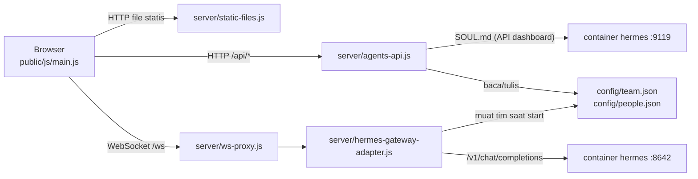

# Arsitektur Agentic Digital Office

Panduan singkat untuk developer yang baru bergabung: apa saja bagiannya, bagaimana data mengalir, dan file mana yang diubah untuk tugas tertentu. Cara instalasi dan pemakaian ada di [PANDUAN.md](PANDUAN.md).

## Gambaran besar

Dua container Docker (lihat `docker-compose.yml`):

- **`hermes`**: image resmi Hermes Agent. Menyediakan API mirip OpenAI di port 8642 dan dashboard di port 9119. Data (API key, SOUL.md, memori, skill) disimpan di volume Docker.
- **`office`**: image yang kita bangun dari folder `office/`. Satu proses Node yang menyajikan UI kantor 3D, API panel agen, dan adapter yang menerjemahkan protokol kantor ke API Hermes.



## Peta folder

```
config/                 data agen (di-mount ke container office, bisa ditulis)
  team.json             daftar agen + persona (nama, peran, instruksi, batasan)
  people.json           tampilan + suara per agen (rambut, warna, kostum, voice)
docs/                   PANDUAN.md (pemakaian), ARCHITECTURE.md (dokumen ini)
office/                 image Docker "office"
  Dockerfile, package.json
  server/               sisi server (Node, CommonJS)
    index.js            titik masuk: routing HTTP + memasang proxy WebSocket
    static-files.js     file UI, three.js dari node_modules, streaming MP3
    ws-proxy.js         meneruskan /ws ke adapter (127.0.0.1)
    agents-api.js       REST panel ⚙ Agen + SOUL.md lewat dashboard Hermes
    projects.js         daftar proyek di /workspace + proyek aktif (config/office.json)
    hermes-gateway-adapter.js   adapter dari Claw3D (MIT): tim, chat, orkestrasi
  public/               sisi browser (ES modules, tanpa build step)
    index.html, style.css
    audio/              MP3 pribadi (tidak masuk git, lihat audio/README.md)
    js/
      main.js           titik masuk UI: menyambungkan semua modul + state aplikasi
      net/gateway.js    klien WebSocket ke adapter (request/response + event)
      world/
        world.js        renderer, kamera, cahaya, agen (meja, kegiatan, gerak)
        routing.js      jalur jalan: koridor, lorong samping, pintu ruangan
      office/           scene kantor
        layout.js       DENAH: ukuran kantor, ruangan, slot meja, titik kegiatan
        index.js        merakit seluruh scene (buildOffice)
        rooms.js        dinding kaca, pintu, papan nama, ruang rapat
        decor.js        lounge, pantry, akuarium, arcade, ping-pong, dll.
        props.js        meja, kursi, lampu, pohon, rak server, ...
        textures.js     tekstur pixel-art (rumput, lantai per ruangan, papan nama)
        helpers.js      material, box/cone, tekstur canvas, random ber-seed
      characters/       karakter voxel
        person.js       membuat karakter dari data tampilan
        head.js         wajah pixel + gaya rambut
        costumes.js     kostum (tema Pokémon, Digimon, anime)
        animation.js    pose per frame (jalan, duduk, rapat, main, ...)
        presets.js      tampilan bawaan
        parts.js        potongan dasar (box, cone, material)
      ui/
        name-tags.js    label nama + gelembung kata (DOM)
        agents-panel.js panel ⚙ Agen (tambah/ubah/hapus agen, SOUL.md)
        projects.js     dropdown 📁 Proyek (proyek yang dikerjakan agen)
        jukebox.js      musik latar (playlist, ulang, sisa waktu)
        voice.js        suara agen (Web Speech API)
```

## Alur saat Anda mengirim pesan ke agen

1. `main.js` mengirim `chat.send` lewat `net/gateway.js`.
2. `ws-proxy.js` meneruskannya ke adapter. Adapter memilih persona agen dari `config/team.json` dan memanggil API Hermes.
3. Jawaban kembali sebagai event `chat` (`delta` lalu `final`).
4. `main.js` memperbarui status agen di `World` (jalan ke meja dan mengetik), menampilkan gelembung kata (`ui/name-tags.js`), membacakan balasan (`ui/voice.js`), dan mencatat ke Aktivitas Terbaru.

## Proyek

`PROJECTS_DIR` dari `.env` di-mount ke kedua container sebagai `/workspace`: baca-tulis di `hermes` (tempat tools agen berjalan), hanya-baca di `office` (untuk daftar proyek). Proyek aktif disimpan di `config/office.json` (tidak di-commit). `server/projects.js` meneruskannya ke adapter lewat `team.setProject()`, lalu adapter menambahkan folder proyek dan aturan branch git ke prompt sistem setiap agen (`withProjectContext` di `hermes-gateway-adapter.js`).

## Siklus hidup agen di World

Setiap agen punya `mode`: `idle` → `wander` atau `toSpot` (berjalan ke properti) → `activity` (memakai properti), atau `toSeat` → `sitting` saat sedang bekerja. Status `working` dari gateway selalu memanggil agen ke mejanya. Jalur dihitung oleh `world/routing.js` lewat koridor dan pintu ruangan.

## Resep tugas umum

| Ingin | Ubah |
| --- | --- |
| Menambah atau memindah ruangan | `ROOMS` di `office/layout.js` (bentuk, dinding, celah pintu, titik pintu, jenis lantai) |
| Menambah properti yang bisa dipakai agen | Model di `office/decor.js`, titik di `ACTIVITY_SPOTS` (`office/layout.js`), pose baru di `characters/animation.js` |
| Menambah kostum | Entri baru di `COSTUMES` (`characters/costumes.js`) + id-nya di daftar `COSTUMES` di `server/agents-api.js` |
| Menambah gaya rambut | `addHair` di `characters/head.js` + pilihan di `ui/agents-panel.js` dan `server/agents-api.js` |
| Menambah lagu | MP3 ke `public/audio/`, entri di `PLAYLIST` (`ui/jukebox.js`) |
| Mengubah API panel agen | `server/agents-api.js` (validasi input ada di sana) |

Setiap perubahan di `office/` perlu `docker compose up -d --build office`, lalu refresh browser.

## Konvensi

- Satu file, satu tanggung jawab. Setiap file diawali komentar singkat yang menjelaskan isinya.
- Browser memakai ES modules dengan import relatif; three.js diimpor sebagai `"three"` lewat import map di `index.html`.
- Server memakai CommonJS (`require`) dan modul bawaan Node, dengan satu dependensi: `ws`.
- Satuan dunia 3D: 1 unit = 1 petak lantai. Sumbu x kiri ke kanan, z belakang ke depan, y ke atas.
- Teks UI berbahasa Indonesia; komentar kode berbahasa Inggris.
- Rahasia hanya di `.env` (tidak pernah di-commit), MP3 pribadi tidak di-commit.
