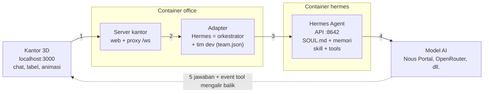

# Panduan Agentic Digital Office

Terakhir diperbarui: 18 Oktober 2026 · versi online: [Panduan Agentic Digital Office](https://claude.ai/code/artifact/09eed842-887e-4dfe-9beb-5de84818f751)

## Ringkasan

Agentic Digital Office adalah tim agen AI (dipimpin orkestrator Hermes, anggotanya Anda buat sendiri) yang tampil sebagai karakter 3D di sebuah kantor virtual. Semuanya berjalan di Docker Desktop dari folder `D:\Coding\digital-agent-office`, dan hanya bisa dibuka dari komputer ini.

| Bagian | Isi | Alamat |
| --- | --- | --- |
| Container `office` | Kantor 3D (three.js) + adapter Hermes | http://localhost:3000 |
| Container `hermes` | Hermes Agent resmi dari Nous Research: otak agen, API, dashboard | Dashboard http://127.0.0.1:9119, API http://127.0.0.1:8642 |
| Volume `digital-agent-office_hermes-data` | Konfigurasi, login provider AI, memori, skill Hermes | (di dalam Docker) |
| Volume `digital-agent-office_office-data` | Riwayat chat tiap agen di kantor | (di dalam Docker) |

Status per hari ini: semua komponen jalan dan agen sudah bisa menjawab serta memakai tools. Hermes tersambung ke Nous Portal dengan model gratis `poolside/laguna-s-2.1:free` (lihat [Memilih provider dan model AI](#memilih-provider-dan-model-ai)).

## Mulai cepat

| Mau | Caranya |
| --- | --- |
| Mengerjakan project kode | Pilih repo di dropdown **📁 Proyek** → klik **Hermes** → beri tugas besar ("Yui susun kebutuhan, Naruto kerjakan frontend, Luffy API-nya, Takumi buat test") → pantau Aktivitas dan panel PERSETUJUAN → cek hasil dengan `git status` / `git diff` di branch `agent/...` |
| Rapat membahas project | **💬 Rapat** → isi topik, centang peserta (maks. 5), pilih jumlah putaran → **Mulai rapat**. Notulen masuk ke 📋 RINGKASAN (lihat [Rapat tim](#rapat-tim-rapat)) |
| Diskusi tanpa mengubah file | Pilih **📁 Pilih proyek…** (kosong) → klik **Hermes** → "Ajak Yui, Sakura, dan Akane diskusi ide X, lalu rangkum dan beri rekomendasi" |
| Ngobrol dengan satu agen | Klik karakternya (atau namanya di header) lalu ketik pesan |

**Riwayat dan ringkasan.** Riwayat chat tiap agen disimpan di server (volume `office-data`), termasuk pesan yang baru dikirim dan balasan yang gagal, jadi tetap ada setelah halaman di-refresh. Kalau di-refresh saat agen masih bekerja, balasannya tetap masuk. Panel **📋 RINGKASAN** di kiri berisi ringkasan singkat setiap kali agen selesai menjawab (siapa, kapan, tugasnya, inti jawabannya); klik salah satunya untuk membuka chat lengkap, atau klik **–** untuk menyembunyikan panel. Centang kotak di setiap ringkasan setelah Anda membacanya (bertanda **Dibaca** dan tampil redup; yang belum bertanda **Baru**). Hanya Anda yang menandai, jumlah yang belum dibaca tampil di judul panel, dan **Tampilkan yang belum dibaca saja** menyaring daftarnya. Tanda baca disimpan di server, jadi tetap ada setelah refresh atau di tab lain.

Agen diminta menjawab singkat (maksimal sekitar 5 kalimat atau 5 poin), kecuali Anda meminta detail. Model gratis kadang tetap menjawab panjang; model yang lebih kuat lebih patuh.

## Instalasi dari awal (laptop/PC baru)

Yang dibutuhkan: Windows 10/11 dengan WSL2, Docker Desktop, Git, koneksi internet, dan ruang disk kosong sekitar 8 GB (image Hermes sekitar 4,5 GB). Hermes dan kantor berjalan di dalam container, jadi tidak perlu memasang Hermes atau Node.js.

1. **Pasang WSL2.** Buka PowerShell sebagai administrator, jalankan `wsl --install`, lalu restart komputer.
2. **Pasang Docker Desktop** dari docker.com. Di Settings → General, pastikan "Use the WSL 2 based engine" aktif, lalu biarkan Docker Desktop menyala.
3. **Pasang Git for Windows** dari git-scm.com (pilihan bawaan sudah cukup).
4. **Ambil proyeknya.** Buka PowerShell di folder tempat menyimpan proyek (misalnya `D:\Coding`), lalu jalankan `git clone https://github.com/Hiraito23/digital-agent-office.git` dan `cd digital-agent-office`.
5. **Buat file `.env`** dari contohnya dengan `copy .env.example .env`, lalu buka `.env` di Notepad dan isi:
    - `API_SERVER_KEY`: kunci acak. Buat di PowerShell dengan `[guid]::NewGuid().ToString('N') + [guid]::NewGuid().ToString('N')`, lalu tempel hasilnya.
    - `DASH_USER`: biarkan `admin`.
    - `DASH_PASS`: password dashboard pilihan Anda (juga dipakai panel ⚙ Agen untuk menyimpan SOUL.md).
    - `PROJECTS_DIR`: folder berisi proyek yang boleh dikerjakan agen, misalnya `D:/Coding` (lihat bagian Mengerjakan proyek). Kosongkan untuk memakai folder `projects/` di repo ini.

    File ini rahasia dan tidak ikut ke GitHub.
6. **(Opsional) Salin musik.** File MP3 tidak ada di GitHub. Kalau ingin ada musik, salin `asuka-city.mp3` dan `littleroot-town.mp3` ke `office\public\audio\` sebelum langkah 7 (untuk lagu lain lihat `office/public/audio/README.md`). Tanpa ini kantor tetap jalan, hanya tanpa musik.
7. **Nyalakan.** Di folder proyek jalankan `docker compose up -d --build`. Pertama kali butuh beberapa menit karena mengunduh image Hermes.
8. **Sambungkan provider AI (wajib, sekali per komputer).** Ikuti [Memilih provider dan model AI](#memilih-provider-dan-model-ai) di bawah: login/isi API key, pilih model, salin `API_SERVER_KEY` ke Hermes, lalu restart.
9. **Buka kantor** di http://localhost:3000 (sebaiknya di Microsoft Edge agar suara Indonesia tersedia) dan **dashboard Hermes** di http://127.0.0.1:9119 (login `admin` + `DASH_PASS`).
10. **Uji.** Klik karakter Hermes dan kirim "Halo, perkenalkan timmu". Kalau muncul "Provider authentication failed", lihat bagian Pemecahan masalah.

Data yang ikut dari GitHub: tim agen beserta tampilan dan suaranya (`config/team.json`, `config/people.json`). Yang **tidak** ikut dan dibuat ulang di tiap komputer: `.env`, API key model, SOUL.md, memori, dan riwayat chat (semuanya tersimpan di volume Docker komputer itu).

Mengambil pembaruan terbaru: `git pull`, lalu `docker compose up -d --build`.

### Memilih provider dan model AI

Hermes butuh satu provider AI. Semua perintah di bawah dijalankan di PowerShell, di folder proyek.

1. **Login atau isi API key.** Jalankan `docker exec -it hermes hermes model`, lalu pilih provider:
    - **Nous Portal** (login lewat browser, ada model gratis). Saldo $0 hanya bisa memakai model berakhiran `:free`; model berbayar seperti Claude Opus akan ditolak dengan pesan "Billing or credits exhausted".
    - **OpenRouter, Anthropic, OpenAI, Gemini, dll.** dengan API key dari situs masing-masing (berbayar sesuai pemakaian).
2. **Pilih model** di menu yang sama. Untuk Nous Portal gratis, `poolside/laguna-s-2.1:free` sudah teruji bisa berbahasa Indonesia dan memakai tools. Bisa juga diatur langsung:
    ```
    docker exec hermes hermes config set model.provider nous
    docker exec hermes hermes config set model.default "poolside/laguna-s-2.1:free"
    ```
3. **Salin `API_SERVER_KEY` ke Hermes.** Setelah wizard `hermes setup`/`hermes model`, Hermes membaca kunci API server dari file `.env` miliknya sendiri. Tanpa langkah ini port 8642 tidak menyala dan kantor tidak bisa bicara dengan Hermes:
    ```
    docker exec hermes sh -c 'grep -q "^API_SERVER_KEY=" /opt/data/.env || printf "\nAPI_SERVER_KEY=%s\n" "$API_SERVER_KEY" >> /opt/data/.env'
    ```
4. **Restart dan uji:** `docker compose restart hermes`, tunggu sekitar 20 detik, lalu kirim pesan ke agen di kantor.

Mengecek status login: `docker exec hermes hermes auth list`. Mengganti model nanti cukup ulangi langkah 2 lalu `docker compose restart hermes`.

### Perintah harian

| Perlu | Perintah (di folder proyek) |
| --- | --- |
| Menyalakan | `docker compose up -d` |
| Mematikan (data tetap aman) | `docker compose down` |
| Melihat log | `docker compose logs -f` |
| Setelah mengganti provider, API key, atau model | `docker compose restart hermes` |
| Menambah, mengubah, menghapus agen | panel **⚙ Agen** di kantor (langsung berlaku) |
| Setelah mengubah apa pun di `office/` (tampilan, server, adapter) | `docker compose up -d --build office`, lalu refresh browser |
| Mengambil pembaruan dari GitHub | `git pull`, lalu `docker compose up -d --build` |

Kedua container memakai `restart: unless-stopped`, jadi ikut menyala sendiri setiap kali Docker Desktop berjalan.

## Cara kerja agen

Setiap pesan dari kantor diteruskan ke mesin Hermes, yang meminta jawaban dari model AI di provider pilihan Anda dan menjalankan tools bila perlu. Jawabannya mengalir balik sedikit demi sedikit, dan itulah yang menggerakkan karakter.



1. **Anda mengetik di kantor** (klik karakter, kirim pesan). Browser mengirimnya lewat WebSocket ke server kantor.
2. **Adapter menentukan siapa yang menjawab.** Pesan ke Hermes diproses dengan kemampuan orkestrator; pesan ke anggota tim (Naruto, Luffy, Sakura, Yui, Takumi, Akane, Daichi) memakai persona mereka dari `team.json`, ditambah folder proyek aktif dan aturan git.
3. **Adapter memanggil Hermes Agent** (`/v1/chat/completions` di port 8642). Hermes menambahkan identitas `SOUL.md`, memori, dan skill, lalu menjalankan tools (terminal, file, web, ...) di container `hermes`.
4. **Hermes meminta model AI** di provider yang Anda pilih lewat `hermes model`. Di sinilah biaya token terjadi (gratis untuk model `:free`).
5. **Jawaban mengalir balik** sebagai event `delta` (sedang menulis) lalu `final` (selesai), ditambah event tool dan permintaan persetujuan. Kantor memakai event ini untuk: karakter berjalan ke meja dan duduk mengetik, menampilkan gelembung kata dan ikon tool, membacakan balasan dengan suara agen, mencatat di Aktivitas Terbaru, lalu kembali bersantai setelah selesai.

### Hermes sebagai orkestrator

Hermes punya enam alat tim yang tidak dimiliki agen lain: `spawn_agent` (merekrut agen baru), `delegate_task` (memberi tugas ke anggota tim), `list_team`, `configure_agent`, `dismiss_agent`, dan `read_agent_context` (membaca pekerjaan anggota lain). Jadi cukup beri Hermes tujuan besar, misalnya "buat fitur login". Hermes membaginya ke Yui (kebutuhan), Sakura (desain), Naruto (frontend), Luffy (backend), dan Takumi (test), lalu merangkum hasilnya. Setiap delegasi terlihat di kantor sebagai karakter yang mulai bekerja.

Agen yang direkrut Hermes saat chat hanya hidup sampai container `office` restart. Agen tetap dibuat lewat panel **⚙ Agen** (tersimpan di `config/team.json`).

## Melatih kepribadian (soul)

Agen tidak "dilatih" ulang seperti model AI. Kepribadiannya dibentuk oleh teks instruksi yang dibaca setiap kali ia menjawab, plus memori yang tumbuh dari percakapan. Ada tiga lapisan, dari yang paling umum ke paling khusus:

| Lapisan | Berlaku untuk | Tempat | Isi yang cocok |
| --- | --- | --- | --- |
| `SOUL.md` | Semua agen (satu mesin Hermes) | Volume `hermes-data` → `/opt/data/SOUL.md` | Nilai dan gaya dasar seluruh kantor: bahasa, nada, kejujuran, cara menangani ketidakpastian |
| Instruksi per agen | Satu agen | Panel ⚙ Agen → Instruksi dan Batasan (`config/team.json`) | Peran, keahlian, gaya bicara khas, batasan |
| Memori | Tumbuh sendiri | Memori bawaan Hermes + riwayat chat di volume `office-data` | Fakta tentang Anda dan proyek, preferensi, hasil kerja sebelumnya |

### Mengubah SOUL.md

Cara termudah: panel **⚙ Agen** → tab **Soul**, edit, lalu **Simpan SOUL.md**. Kantor menyimpannya lewat API resmi dashboard Hermes.

Menurut [dokumentasi Hermes](https://hermes-agent.nousresearch.com/docs/user-guide/features/personality), `SOUL.md` adalah identitas utama agen dan menempati posisi pertama di system prompt. Isinya sebaiknya panduan yang tahan lama (nada, keterusterangan, hal yang dihindari), bukan detail proyek.

Cara manual (alternatif):

1. Salin keluar: `docker cp hermes:/opt/data/SOUL.md .\SOUL.md`
2. Edit di VS Code atau Notepad.
3. Salin kembali: `docker cp .\SOUL.md hermes:/opt/data/SOUL.md`, lalu `docker compose restart hermes`.

Contoh isi singkat: "Kamu bagian dari tim Agentic Digital Office. Selalu jawab dalam Bahasa Indonesia yang santai tapi sopan. Akui kalau tidak tahu, jangan mengarang angka. Utamakan jawaban ringkas dengan langkah yang bisa langsung dikerjakan."

### Menulis persona per agen

Isi kolom **Instruksi / kepribadian** dan **Batasan** di panel ⚙ Agen. Resep persona yang efektif:

- **Siapa dan untuk apa:** "Kamu adalah Takumi, QA Engineer yang menguji aplikasi web React + NestJS."
- **Cara kerja:** langkah yang selalu dia ikuti, misalnya "selalu tulis langkah reproduksi dan hasil yang diharapkan".
- **Gaya bicara:** satu sampai dua ciri khas, misalnya "suka memakai perumpamaan" atau "to the point, pakai poin-poin".
- **Batasan:** apa yang tidak boleh dilakukan, misalnya "jangan menghapus file tanpa konfirmasi".
- **Format hasil:** misalnya "akhiri dengan ringkasan tiga poin".

Id agen tidak bisa diubah setelah dibuat. Riwayat chat, tampilan, dan suara terikat ke id itu.

### Memperkuat lewat pemakaian

- Koreksi langsung di chat ("lain kali pakai format tabel"). Hermes menyimpan hal penting ke memori.
- Kalau ada pola kerja yang terus diulang, jadikan skill (lihat bagian berikut) agar konsisten.
- Personality sementara tersedia lewat perintah `/personality` di chat Hermes (misalnya `concise`, `teacher`). Ini hanya lapisan sesi dan tidak mengubah `SOUL.md`.

## Kantor dan kegiatan agen

Kantor punya dua bagian. **Aula utama** (kiri) berisi ruang bersama berdinding kaca dengan pintu dan papan nama: **Ruang Rapat** (meja rapat, whiteboard, rak buku), **Ruang Server**, **Pantry & Lounge** (kopi, akuarium, sofa), **Ruang Game** (arcade, ping-pong), **Lobby** (portal Hermes dan pintu masuk), dan area tengah yang lapang untuk berjalan. **Sayap ruang pribadi** (kanan) berisi 8 ruang kerja, empat di belakang dan empat di depan koridor; masing-masing punya meja, kursi, rak, tanaman, dan papan nama "RUANG <NAMA AGEN>" di atas pintunya. Agen masuk dan keluar ruangan lewat pintu.

**Satu agen satu ruang:** Hermes mendapat ruang pertama, lalu anggota tim diurutkan menurut id. Saat mendapat tugas, agen berjalan ke ruangnya sendiri, duduk, dan mengetik; setelah selesai ia keluar ke koridor. Ruang yang belum terpakai bertanda "(KOSONG)". Kalau agen lebih dari 8, meja terbuka baru muncul di aula utama untuk agen berikutnya (maksimal 10 meja). Menambah atau menghapus agen di panel ⚙ Agen langsung memperbarui papan nama.

Saat santai, agen memakai properti kantor dan ikon kegiatannya tampil di label nama:

| Properti | Kegiatan | Ikon |
| --- | --- | --- |
| Sofa dan bean bag di area santai | Duduk bersantai | 🛋 |
| Pantry (mesin kopi, microwave) | Minum kopi | ☕ |
| Akuarium | Melihat ikan | 🐟 |
| Rak buku | Membaca | 📖 |
| Whiteboard dengan sticky note | Menulis | ✍ |
| Meja rapat (4 kursi) | Rapat | 💬 |
| Rak server | Cek server | 🖥 |
| Dua mesin arcade | Main game | 🎮 |
| Meja ping-pong | Main ping-pong | 🏓 |

Dekorasi lain: karpet, meja kopi, papan neon, jam dinding, dan tanaman besar di sudut. Satu properti hanya dipakai satu agen dalam satu waktu; kegiatan berlangsung sekitar 9 sampai 18 detik.

## Mengerjakan proyek (📁 Proyek)

Agen bisa membaca dan menulis kode di proyek Anda. Folder `PROJECTS_DIR` di `.env` (misalnya `D:/Coding`) di-mount ke container Hermes sebagai `/workspace`.

1. Pilih proyek di dropdown **📁 Proyek** di header kantor. Daftarnya hanya berisi repo git: folder di `PROJECTS_DIR` yang punya git, plus repo git satu tingkat di bawahnya (misalnya `Kalla/oase-tanjung`), lengkap dengan branch aktifnya. Folder tanpa git tidak muncul; untuk project baru, jalankan `git init` di foldernya dulu.
2. Beri tugas ke Hermes atau langsung ke agen, misalnya "Tambahkan halaman daftar pelanggan sesuai struktur folder yang ada". Semua agen, termasuk yang didelegasikan Hermes, otomatis tahu folder proyeknya.
3. Cek hasilnya di folder proyek dengan `git status`, `git log`, dan `git diff`.

Aturan yang selalu diberikan ke agen:

- Sebelum mengubah file, agen memeriksa branch. Kalau belum di branch yang diawali `agent/`, agen membuat **satu branch kerja bersama** untuk tugas itu (`agent/<nama-tugas>`), dan seluruh tim memakai branch itu.
- Tidak pernah commit atau push ke `main`, `master`, atau `develop`; tidak force push; tidak menghapus branch. Push hanya kalau Anda memintanya.
- Tidak membaca atau mengubah file rahasia (`.env`, kunci, kredensial).

Perlu diingat: dengan fitur ini agen bisa membuat, mengubah, dan menghapus file serta menjalankan perintah terminal di folder proyek. Aturan di atas adalah instruksi untuk agen, bukan pengaman teknis, jadi selalu tinjau perubahan sebelum di-merge. Pilih **📁 Pilih proyek…** (kosong) kalau tidak ingin agen bekerja di proyek mana pun.

## Rapat tim (💬 Rapat)

Untuk membahas sebuah project bersama beberapa agen sekaligus:

1. Pilih proyeknya di **📁 Proyek** (opsional, supaya rapat tahu konteksnya).
2. Klik **💬 Rapat** di header, isi **topik**, centang **peserta** (maksimal 5, sesuai kursi di Ruang Rapat), lalu pilih **putaran bicara** (1 sampai 3).
3. Klik **💬 Mulai rapat**. Hermes berjalan ke whiteboard, peserta duduk di kursi Ruang Rapat (ikon 💬 di label nama).
4. Hermes membuka rapat, lalu tiap peserta bicara bergiliran 2 sampai 4 kalimat dari sudut pandang perannya; gelembung kata dan transkrip di panel menunjukkan siapa yang sedang bicara.
5. Hermes menutup rapat dengan **notulen**: Ringkasan, Keputusan, dan Action item per orang. Notulen muncul di panel rapat dan di **📋 RINGKASAN**, dan tersimpan di riwayat chat setiap peserta, jadi Anda bisa melanjutkan, misalnya ke Naruto: "kerjakan action item-mu dari rapat tadi".

Tombol **Salin notulen** dan **Unduh .md** menyimpan notulen + transkrip. **■ Akhiri rapat** menghentikan rapat kapan saja. Selama rapat agen hanya berdiskusi, tidak mengubah file. Peserta yang modelnya tidak merespons selama 90 detik dilewati supaya rapat tetap berjalan. Lama rapat kira-kira (1 + peserta × putaran + 1) giliran × 5 sampai 15 detik.

## Tools Hermes (🧰 Tools dan PERSETUJUAN)

Semua agen memakai tools bawaan Hermes, yang berjalan di container `hermes`: terminal, operasi file (baca, tulis, patch, cari), eksekusi kode, browser otomatis, pencarian web, memori, skill, cron, todo, pembuatan gambar, analisis gambar, dan lainnya. Kantor menampilkan pemakaiannya:

- **Label nama**: saat agen memakai tool, ikon tool (misalnya 💻 terminal atau 📁 file) muncul di depan namanya dan gelembung kata menampilkan perintahnya.
- **Aktivitas Terbaru**: setiap pemanggilan tool tercatat, misalnya "Takumi 💻 terminal: npm test".
- **Panel PERSETUJUAN** (kanan bawah): perintah yang dianggap berisiko oleh Hermes (misalnya menghapus folder) menunggu izin Anda. Pilih **Izinkan sekali**, **Izinkan sesi ini**, **Selalu izinkan**, atau **Tolak**. Agen menunggu sampai Anda menjawab.
- **⚙ Agen → 🧰 Tools**: daftar toolset Hermes beserta statusnya (aktif, nonaktif, atau perlu kunci API). Daftar ini hanya untuk dilihat. Untuk mengaktifkan, menonaktifkan, atau mengisi kunci API tool (misalnya pencarian web atau pembuatan gambar), buka dashboard Hermes di http://localhost:9119, lalu jalankan `docker compose restart hermes`.

## Mengelola agen (panel ⚙ Agen)

Semua pengelolaan agen dilakukan dari kantor, tanpa edit file dan tanpa restart. Klik **⚙ Agen** di kanan atas.

| Mau | Caranya |
| --- | --- |
| Tambah agen | Tab **Tim** → **＋ Agen baru**, isi nama, peran, instruksi, tampilan, suara → **Simpan**. Karakternya langsung muncul di kantor |
| Ubah agen | Tab **Tim** → **Ubah** di agen itu → ubah persona, tampilan, atau suara → **Simpan** |
| Hapus agen | **Ubah** → **Hapus agen** → konfirmasi. Riwayat chat agen itu ikut terhapus |
| Update soul (semua agen) | Tab **Soul** → edit → **Simpan SOUL.md** |
| Lihat tools yang tersedia | Tab **🧰 Tools** (pengaturannya di dashboard Hermes) |
| Pakai kostum | Form agen → **Kostum** → pilih dari Tema Pokémon, Tema Digimon, atau Tema Anime → **Simpan** |
| Pilih suara | Form agen → **Suara pilihan** → pilih dari daftar suara yang tersedia di browser (atau Otomatis) |
| Coba suara | Di form agen → **🔊 Tes suara** (pakai pengaturan yang belum disimpan) |

Hermes (orkestrator) tidak bisa dihapus; personanya diatur lewat SOUL.md, tapi tampilan dan suaranya bisa diubah. Data tersimpan di `config/team.json` dan `config/people.json`, jadi tetap ada setelah restart.

## Skill

Skill adalah "buku panduan" yang dibaca agen hanya saat dibutuhkan, misalnya cara membuat laporan riset atau cara mereview kode. Formatnya file `SKILL.md` mengikuti standar agentskills.io, disimpan di `/opt/data/skills/` di dalam container Hermes ([dokumentasi](https://hermes-agent.nousresearch.com/docs/user-guide/features/skills)).

Di setup ini skill dipasang ke mesin Hermes, jadi **bisa dipakai semua agen**. Skill khusus satu agen butuh profil Hermes terpisah per agen (lihat catatan di akhir bagian ini).

### Memasang skill dari hub

| Perlu | Perintah |
| --- | --- |
| Menjelajah skill | `docker exec -it hermes hermes skills browse` |
| Mencari berdasarkan topik | `docker exec -it hermes hermes skills search riset` |
| Melihat isi sebelum pasang | `docker exec -it hermes hermes skills inspect <nama>` |
| Memasang (dipindai keamanannya) | `docker exec -it hermes hermes skills install <nama>` |
| Daftar yang terpasang | `docker exec -it hermes hermes skills list` |
| Memperbarui / menghapus | `hermes skills update` / `hermes skills uninstall <nama>` |

Selalu jalankan `inspect` dulu. Skill dari pihak ketiga bisa berisi skrip.

### Membuat skill sendiri

Buat folder berisi `SKILL.md` dengan bagian: frontmatter (`name`, `description`, `version`), lalu `When to Use`, `Procedure`, `Pitfalls`, `Verification`. Folder pendukung opsional: `templates/`, `scripts/`, `references/`. Salin ke container dengan `docker cp .\nama-skill hermes:/opt/data/skills/`.

Agen juga bisa membuat dan memperbaiki skill sendiri lewat tool `skill_manage`, misalnya setelah Anda bilang "simpan cara kerja tadi sebagai skill". Untuk mereview dulu sebelum disimpan, aktifkan `skills.write_approval: true` di `config.yaml`, lalu pakai `/skills pending`, `/skills approve <id>`, atau `/skills reject <id>`.

### Skill yang disarankan per peran

Cari dengan `hermes skills search <kata kunci>` lalu pilih yang paling cocok.

| Agen | Peran | Kata kunci pencarian | Skill buatan sendiri yang berguna |
| --- | --- | --- | --- |
| Hermes | Orkestrator | planning, project management | Cara membagi tugas ke tim dan format laporan akhir |
| Naruto | Frontend Developer | react, nextjs, tailwind | Struktur folder dan pola komponen proyek |
| Luffy | Backend Developer | nestjs, express, api | Standar endpoint, DTO, dan validasi |
| Sakura | UI/UX Designer | figma, design system, ux | Checklist aksesibilitas dan design token |
| Yui | Product Manager | planning, prd, user story | Template PRD dan user story |
| Takumi | QA Engineer | testing, playwright, jest | Checklist regresi dan format laporan bug |
| Akane | Cyber Security Engineer | security, owasp, audit | Checklist review keamanan |
| Daichi | Infra & Database Engineer | docker, mysql, ci | Prosedur migrasi database dan deploy |

**Catatan skill per agen:** semua agen di kantor berbagi satu mesin Hermes. Kalau suatu saat butuh skill, memori, atau model yang benar-benar terpisah per agen, langkahnya adalah membuat profil Hermes per agen (`hermes profile create`), masing-masing dengan port API sendiri, lalu mengarahkan agen itu ke profilnya. Ini perubahan lanjutan pada adapter.

## Suara per agen

Setiap agen membacakan balasannya dengan suaranya sendiri, memakai suara bawaan browser (Web Speech API): gratis dan tidak butuh API key. Suara terbaik didapat dengan membuka kantor di **Microsoft Edge**, yang menyediakan suara neural Microsoft "Online (Natural)" seperti Gadis (wanita) dan Ardi (pria) untuk semua halaman web.

### Cara pakai

- **🔊 Suara** di kanan atas: menyalakan atau mematikan suara. Pilihan ini diingat browser.
- **🔊 Tes** di panel chat: memperdengarkan suara agen yang sedang dipilih. Arahkan kursor ke tombol itu untuk melihat nama suara yang dipakai.
- Yang dibacakan hanya kalimat-kalimat awal balasan (maks. sekitar 240 karakter). Kode dan link dilewati, teks lengkap tetap di chat.
- Saat agen bicara, kepalanya mengangguk, tangannya bergerak, labelnya bertanda ♪, dan volume musik otomatis turun.
- Kalau browser tidak punya suara Indonesia, muncul petunjuk di Aktivitas Terbaru. Kantor tidak memakai suara bahasa lain agar tidak terdengar berlogat asing.

### Mengatur suara tiap agen

Atur di panel ⚙ Agen → Ubah → bagian **Suara** (jenis, nada, kecepatan, suara pilihan, plus tombol Tes suara). Tersimpan di `config/people.json` → `voice`.

| Agen | Jenis | Nada (`pitch`) | Kecepatan (`rate`) |
| --- | --- | --- | --- |
| Hermes | Wanita | 1.0 | 1.0 |
| Naruto | Pria | 1.05 | 1.1 |
| Luffy | Pria | 0.85 | 0.95 |
| Sakura | Wanita | 1.2 | 1.0 |
| Yui | Wanita | 1.0 | 0.95 |
| Takumi | Pria | 1.0 | 1.0 |
| Akane | Wanita | 0.9 | 1.05 |
| Daichi | Pria | 0.8 | 0.9 |

**Suara pilihan** berupa daftar suara yang benar-benar ada di browser Anda (suara Indonesia di atas). Pilih **Otomatis** agar kantor memilih suara Indonesia terbaik sesuai jenis. Di file, kolomnya: `lang` = bahasa (`id-ID`), `gender` = `male` atau `female`, `prefer` = nama suara yang dipilih, `pitch` dan `rate` = 0.5 sampai 2 (1 = normal). Kalau hanya ada satu suara Indonesia, agen tetap terdengar berbeda lewat nada dan kecepatan.

### Kalau tidak ada suara Indonesia

1. Buka kantor di Microsoft Edge (paling mudah).
2. Atau pasang paket suara Windows: Settings → Time & language → Language & region → Add a language → Indonesia, centang "Text-to-speech", lalu restart browser.

### Untuk suara yang lebih natural

Layanan resmi berbayar seperti Azure AI Speech, ElevenLabs, atau OpenAI TTS bisa ditambahkan nanti. API key-nya disimpan di `.env` dan dipanggil dari server kantor, dengan `voice_id` berbeda per agen. Server Edge TTS tidak dipakai karena aksesnya dibatasi untuk aplikasi Edge sendiri.

## Musik latar

Jukebox memutar playlist dari file lokal di `office/public/audio/`, tanpa internet, berurutan lalu kembali ke awal:

1. `asuka-city.mp3`: Title / Asuka City, Digimon World 3 OST
2. `littleroot-town.mp3`: Littleroot Town, Pokémon Omega Ruby & Alpha Sapphire

Kontrol di panel jukebox: ⏮ lagu sebelumnya (atau ulang dari awal kalau lagu sudah berjalan lebih dari 3 detik), ▶/❚❚ putar/jeda, ⏭ lagu berikutnya, mode ulang (🔁 ulangi semua, 🔂 ulangi lagu ini, ➡ tanpa ulang, berhenti setelah lagu terakhir), bilah progres dengan waktu berjalan dan sisa waktu (klik untuk melompat), serta volume. Pilihan lagu, mode ulang, dan volume diingat browser. Menambah lagu: salin MP3 ke `office/public/audio/`, lalu tambahkan satu baris di daftar `PLAYLIST` di `office/public/js/ui/jukebox.js`.

- Musik menyala otomatis: langsung saat halaman dibuka kalau browser mengizinkan, atau pada klik/tombol/scroll pertama kalau diblokir. Untuk benar-benar tanpa klik, izinkan **Sound** (Edge: **Media autoplay**) untuk `localhost:3000` di Site settings browser.
- **♪ Musik** membuka panel kecil berisi Putar/Jeda dan volume. Musik hanya mati kalau Anda menekan Jeda, dan pilihan itu diingat.
- File MP3 ini lagu milik Bandai dan Nintendo/The Pokémon Company untuk pemakaian pribadi. Jangan ikut dibagikan kalau folder proyek diunggah atau dipublikasikan.

## Struktur file dan kustomisasi

| File | Fungsi | Setelah diubah |
| --- | --- | --- |
| `docker-compose.yml` | Definisi dua container, port, volume | `docker compose up -d` |
| `.env` | Rahasia: `API_SERVER_KEY`, `DASH_USER`, `DASH_PASS` | `docker compose up -d` |
| `config/team.json` | Daftar agen dan persona (diedit panel ⚙ Agen) | Otomatis dari panel; edit manual → `docker compose restart office` |
| `docs/PANDUAN.md` | Panduan ini | – |
| `config/people.json` | Tampilan karakter dan suara (diedit panel ⚙ Agen) | Otomatis dari panel; edit manual → refresh browser |
| `office/server/` | Server web, API panel ⚙ Agen + SOUL.md, proxy WebSocket, adapter Hermes (Claw3D, MIT) | `docker compose up -d --build office` |
| `office/public/js/office/` | Scene kantor: denah `layout.js` (ruangan, meja, titik kegiatan), dinding, dekorasi, properti, tekstur | `docker compose up -d --build office` |
| `office/public/js/characters/` | Karakter voxel: rambut, wajah, kostum, animasi | `docker compose up -d --build office` |
| `office/public/js/world/` | Kamera, cahaya, perilaku dan jalur jalan agen | `docker compose up -d --build office` |
| `office/public/js/ui/` | Label nama, panel ⚙ Agen, proyek, persetujuan, jukebox, suara | `docker compose up -d --build office` |
| `office/public/js/main.js` | Titik masuk UI: menyambungkan semua modul, chat, aktivitas | `docker compose up -d --build office` |

Kostum (menggantikan rambut dan pakaian, warna kulit dan kacamata tetap): Tema Pokémon = Tikus Listrik, Kadal Api, Kura Air, Kodok Daun, Rubah Cokelat; Tema Digimon = Dino Oranye, Serigala Bertanduk, Naga Biru, Bayi Bersayap; Tema Anime = Ninja Oranye, Seragam Pelaut, Gakuran Sekolah, Petarung Gi, Bajak Laut Topi Jerami, Penyihir (kostum anime tetap memakai rambut, plus seragam dan atribut seperti ikat kepala atau topi). Desainnya voxel orisinal yang terinspirasi tema, tanpa nama atau logo resmi.

Pilihan tampilan: `hair` = `short`, `long`, `bob`, `ponytail`, `bun`, `spiky`, `cap`; `outfit` = `shirt`, `blazer`, `hoodie`, `dress`; `accessory` = `glasses` atau `headset`. Tombol ▦ di kantor mengganti gaya HD, Pixel, atau Retro.

Peta lengkap untuk developer ada di [ARCHITECTURE.md](ARCHITECTURE.md).

### Pemecahan masalah

| Gejala | Penyebab | Solusi |
| --- | --- | --- |
| Balasan "Provider authentication failed" | Belum login provider, atau `model.provider` masih `auto` padahal hanya ada login Nous | `docker exec hermes hermes auth list`; lalu ikuti [Memilih provider dan model AI](#memilih-provider-dan-model-ai) |
| "Billing or credits exhausted" | Model berbayar dengan saldo Nous $0 | Pilih model `:free` (mis. `poolside/laguna-s-2.1:free`) atau isi kredit di portal.nousresearch.com |
| Semua agen gagal / status kantor terhubung tapi tidak ada balasan, log Hermes "No messaging platforms enabled" | API server Hermes (port 8642) tidak menyala karena `API_SERVER_KEY` belum ada di `.env` Hermes | Jalankan langkah 3 di [Memilih provider dan model AI](#memilih-provider-dan-model-ai), lalu `docker compose restart hermes` |
| Kantor tidak terbuka | Docker Desktop mati atau container berhenti | Nyalakan Docker Desktop, lalu `docker compose up -d` |
| Status "Terputus" di kantor | Container `office` sedang restart | Tunggu 10 detik; cek `docker compose logs office` |
| Agen baru tidak muncul | Halaman belum menerima pembaruan | Refresh browser; kalau team.json diedit manual, `docker compose restart office` |
| Simpan SOUL.md gagal | Login dashboard salah atau container hermes mati | Cek `DASH_USER`/`DASH_PASS` di `.env`, lalu `docker compose up -d` |
| Tampilan lama setelah edit | Image belum di-build ulang, atau cache browser | `docker compose up -d --build office`, lalu Ctrl+F5 |
| Musik tidak bunyi | Browser butuh interaksi pertama, atau file MP3 belum disalin | Klik di mana saja di kantor; kalau jukebox bilang file belum ada, salin MP3 ke `office/public/audio/` lalu `docker compose up -d --build office` |
| Agen tidak bersuara / berlogat asing | Tidak ada suara Indonesia di browser | Buka di Microsoft Edge, atau pasang paket suara Indonesia |
| Agen diam lama tanpa membalas | Hermes menunggu persetujuan perintah | Jawab di panel PERSETUJUAN (kanan bawah) |
| Tool gagal karena kunci API | Toolset belum dikonfigurasi | Lihat ⚙ Agen → 🧰 Tools, isi kuncinya di dashboard Hermes (port 9119), lalu `docker compose restart hermes` |
| Perintah `hermes` tidak dikenal di PowerShell | Hermes ada di dalam container | Pakai `docker exec -it hermes hermes ...` |

Semua komponen hanya berjalan lewat Docker: kode kantor ada di dalam image `digital-agent-office/office:local`, dan yang di-mount dari folder ini hanya `config/` (data agen) serta folder proyek `PROJECTS_DIR`. Instalasi percobaan awal di Ubuntu (WSL) sudah dihapus pada 18 Oktober 2026; cadangan `.bashrc` lama tersimpan di `~/.bashrc.bak-kantor-hermes`.
