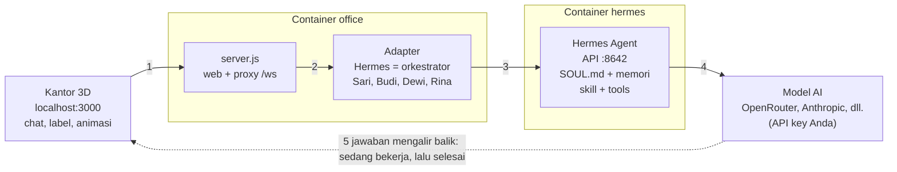

# Panduan Agentic Digital Office

Terakhir diperbarui: 18 Oktober 2026 · versi online: [Panduan Agentic Digital Office](https://claude.ai/code/artifact/09eed842-887e-4dfe-9beb-5de84818f751)

## Ringkasan

Agentic Digital Office adalah tim agen AI (dipimpin orkestrator Hermes, anggotanya Anda buat sendiri) yang tampil sebagai karakter 3D di sebuah kantor virtual. Semuanya berjalan di Docker Desktop dari folder `D:\Coding\kantor-hermes`, dan hanya bisa dibuka dari komputer ini.

| Bagian | Isi | Alamat |
| --- | --- | --- |
| Container `office` | Kantor 3D (three.js) + adapter Hermes | http://localhost:3000/office |
| Container `hermes` | Hermes Agent resmi dari Nous Research: otak agen, API, dashboard | Dashboard http://127.0.0.1:9119, API http://127.0.0.1:8642 |
| Volume `kantor-hermes_hermes-data` | Konfigurasi, API key, memori, skill Hermes | (di dalam Docker) |
| Volume `kantor-hermes_office-data` | Riwayat chat tiap agen di kantor | (di dalam Docker) |

Status per hari ini: semua komponen jalan dan terhubung. Agen belum bisa menjawab sampai API key model diisi lewat `hermes setup` (lihat langkah 6 di bagian instalasi).

## Instalasi dari awal

Yang dibutuhkan hanya Windows 10/11 dengan WSL2 dan Docker Desktop. Hermes dan kantor berjalan di dalam container, jadi tidak perlu memasang Hermes atau Node.js di Ubuntu.

1. **Pasang WSL2.** Buka PowerShell sebagai administrator, jalankan `wsl --install`, lalu restart komputer.
2. **Pasang Docker Desktop** dari docker.com. Di Settings → General, pastikan "Use the WSL 2 based engine" aktif. Biarkan Docker Desktop menyala setiap kali ingin memakai kantor.
3. **Siapkan folder proyek** `D:\Coding\kantor-hermes` berisi `docker-compose.yml`, `README.md`, folder `config/` (`team.json`, `people.json`), dan folder `office/` (lihat bagian Struktur file).
4. **Buat file `.env`** di folder itu dengan tiga baris: `API_SERVER_KEY` (kunci acak minimal 32 karakter), `DASH_USER=admin`, dan `DASH_PASS` (password dashboard). File ini rahasia dan tidak boleh dibagikan.
5. **Nyalakan semuanya.** Buka PowerShell di folder proyek, jalankan `docker compose up -d --build`. Build pertama butuh beberapa menit karena mengunduh image Hermes.
6. **Isi API key model (wajib, sekali saja).** Jalankan `docker exec -it hermes hermes setup`, pilih provider (mis. OpenRouter, Anthropic, atau Nous Portal), lalu tempel API key Anda. Setelah itu jalankan `docker compose restart`.
7. **Buka kantor** di http://localhost:3000/office dan **dashboard Hermes** di http://127.0.0.1:9119 (login `admin` + `DASH_PASS`).
8. **Uji.** Klik karakter Hermes, kirim pesan "Halo, perkenalkan timmu". Kalau masih muncul "Provider authentication failed", ulangi langkah 6.

### Perintah harian

| Perlu | Perintah (di folder proyek) |
| --- | --- |
| Menyalakan | `docker compose up -d` |
| Mematikan (data tetap aman) | `docker compose down` |
| Melihat log | `docker compose logs -f` |
| Setelah mengganti API key | `docker compose restart` |
| Menambah, mengubah, menghapus agen | panel **⚙ Agen** di kantor (langsung berlaku) |
| Setelah mengubah apa pun di `office/` (tampilan, `server.js`, adapter) | `docker compose up -d --build office`, lalu refresh browser |

Kedua container memakai `restart: unless-stopped`, jadi ikut menyala sendiri setiap kali Docker Desktop berjalan.

## Cara kerja agen

Setiap pesan dari kantor diteruskan ke mesin Hermes, yang meminta jawaban dari model AI memakai API key Anda. Jawabannya mengalir balik sedikit demi sedikit, dan itulah yang menggerakkan karakter.

1. **Anda mengetik di kantor** (klik karakter, kirim pesan). Browser mengirimnya lewat WebSocket ke `server.js`.
2. **Adapter menentukan siapa yang menjawab.** Pesan ke Hermes diproses dengan kemampuan orkestrator; pesan ke Sari/Budi/Dewi/Rina memakai persona mereka dari `team.json`.
3. **Adapter memanggil Hermes Agent** (`/v1/chat/completions` di port 8642). Hermes menambahkan identitas `SOUL.md`, memori, dan skill/tools yang relevan.
4. **Hermes meminta model AI** di provider yang Anda pilih saat `hermes setup`. Di sinilah biaya token terjadi.
5. **Jawaban mengalir balik** sebagai event `delta` (sedang menulis) lalu `final` (selesai). Kantor memakai event ini untuk: karakter berjalan ke meja dan duduk mengetik, menampilkan gelembung kata, membacakan balasan dengan suara agen, mencatat di Aktivitas Terbaru, lalu kembali bersantai setelah selesai.

### Hermes sebagai orkestrator

Hermes punya enam alat tim yang tidak dimiliki agen lain: `spawn_agent` (merekrut agen baru), `delegate_task` (memberi tugas ke anggota tim), `list_team`, `configure_agent`, `dismiss_agent`, dan `read_agent_context` (membaca pekerjaan anggota lain). Jadi cukup beri Hermes tujuan besar, misalnya "buat rencana peluncuran produk kopi". Hermes membaginya ke Sari (rencana), Budi (riset), dan Rina (copy), lalu merangkum hasilnya. Setiap delegasi terlihat di kantor sebagai karakter yang mulai bekerja.

Agen yang direkrut Hermes saat chat hanya hidup sampai container `office` restart. Agen tetap dibuat lewat panel **⚙ Agen** (tersimpan di `config/team.json`).

## Melatih kepribadian (soul)

Agen tidak "dilatih" ulang seperti model AI. Kepribadiannya dibentuk oleh teks instruksi yang dibaca setiap kali ia menjawab, plus memori yang tumbuh dari percakapan. Ada tiga lapisan, dari yang paling umum ke paling khusus:

| Lapisan | Berlaku untuk | Tempat | Isi yang cocok |
| --- | --- | --- | --- |
| `SOUL.md` | Semua agen (satu mesin Hermes) | Volume `hermes-data` → `/opt/data/SOUL.md` | Nilai dan gaya dasar seluruh kantor: bahasa, nada, kejujuran, cara menangani ketidakpastian |
| Instruksi per agen | Satu agen | Panel ⚙ Agen → Instruksi dan Batasan (`config/team.json`) | Peran, keahlian, gaya bicara khas, batasan |
| Memori | Tumbuh sendiri | Memori bawaan Hermes + riwayat chat di volume `office-data` | Fakta tentang Anda dan proyek, preferensi, hasil kerja sebelumnya |

### Mengubah SOUL.md

Cara termudah: panel **⚙ Agen** → tab **Soul**, edit, lalu **Simpan SOUL.md**. Kantor menyimpannya lewat API resmi dashboard Hermes.

Menurut [dokumentasi Hermes](https://hermes-agent.nousresearch.com/docs/user-guide/features/personality), `SOUL.md` adalah identitas utama agen dan menempati posisi pertama di system prompt. Isinya sebaiknya panduan yang tahan lama (nada, keterusterangan, hal yang dihindari), bukan detail proyek.

Cara manual (alternatif):

1. Salin keluar: `docker cp hermes:/opt/data/SOUL.md .\SOUL.md`
2. Edit di VS Code atau Notepad.
3. Salin kembali: `docker cp .\SOUL.md hermes:/opt/data/SOUL.md`, lalu `docker compose restart hermes`.

Contoh isi singkat: "Kamu bagian dari tim Agentic Digital Office. Selalu jawab dalam Bahasa Indonesia yang santai tapi sopan. Akui kalau tidak tahu, jangan mengarang angka. Utamakan jawaban ringkas dengan langkah yang bisa langsung dikerjakan."

### Menulis persona per agen

Isi kolom **Instruksi / kepribadian** dan **Batasan** di panel ⚙ Agen. Resep persona yang efektif:

- **Siapa dan untuk apa:** "Kamu adalah Budi, peneliti pasar untuk UMKM makanan di Indonesia."
- **Cara kerja:** langkah yang selalu dia ikuti, misalnya "selalu sertakan sumber dan tanggal data".
- **Gaya bicara:** satu sampai dua ciri khas, misalnya "suka memakai perumpamaan" atau "to the point, pakai poin-poin".
- **Batasan:** apa yang tidak boleh dilakukan, misalnya "jangan menghapus file tanpa konfirmasi".
- **Format hasil:** misalnya "akhiri dengan ringkasan tiga poin".

Id agen tidak bisa diubah setelah dibuat. Riwayat chat, tampilan, dan suara terikat ke id itu.

### Memperkuat lewat pemakaian

- Koreksi langsung di chat ("lain kali pakai format tabel"). Hermes menyimpan hal penting ke memori.
- Kalau ada pola kerja yang terus diulang, jadikan skill (lihat bagian berikut) agar konsisten.
- Personality sementara tersedia lewat perintah `/personality` di chat Hermes (misalnya `concise`, `teacher`). Ini hanya lapisan sesi dan tidak mengubah `SOUL.md`.

## Kantor dan kegiatan agen

Kantor dibagi menjadi beberapa ruangan berdinding kaca dengan pintu dan papan nama: **Ruang Kerja** (meja agen), **Ruang Rapat** (meja rapat, whiteboard, rak buku), **Ruang Server**, **Pantry & Lounge** (kopi, akuarium, sofa), **Ruang Game** (arcade, ping-pong), dan **Lobby** (portal Hermes dan pintu masuk). Agen masuk dan keluar ruangan lewat pintunya.

Setiap agen (termasuk Hermes) punya satu meja dan kursi sendiri. Jumlah meja otomatis mengikuti jumlah agen, maksimal 10 meja di dua baris. Saat mendapat tugas, agen berjalan ke mejanya dan mengetik.

Saat santai, agen memakai properti kantor dan ikon kegiatannya tampil di label nama:

| Properti | Kegiatan | Ikon |
| --- | --- | --- |
| Sofa dan bean bag di area santai | Duduk bersantai | 🛋 |
| Pantry (mesin kopi, microwave) | Minum kopi | ☕ |
| Akuarium | Melihat ikan | 🐟 |
| Rak buku | Membaca | 📖 |
| Whiteboard dengan sticky note | Menulis | ✍ |
| Meja rapat (4 kursi) | Rapat | 💬 |
| Rak server | Cek server | 🖥 |
| Dua mesin arcade | Main game | 🎮 |
| Meja ping-pong | Main ping-pong | 🏓 |

Dekorasi lain: karpet, meja kopi, papan neon, jam dinding, dan tanaman besar di sudut. Satu properti hanya dipakai satu agen dalam satu waktu; kegiatan berlangsung sekitar 9 sampai 18 detik.

## Mengelola agen (panel ⚙ Agen)

Semua pengelolaan agen dilakukan dari kantor, tanpa edit file dan tanpa restart. Klik **⚙ Agen** di kanan atas.

| Mau | Caranya |
| --- | --- |
| Tambah agen | Tab **Tim** → **＋ Agen baru**, isi nama, peran, instruksi, tampilan, suara → **Simpan**. Karakternya langsung muncul di kantor |
| Ubah agen | Tab **Tim** → **Ubah** di agen itu → ubah persona, tampilan, atau suara → **Simpan** |
| Hapus agen | **Ubah** → **Hapus agen** → konfirmasi. Riwayat chat agen itu ikut terhapus |
| Update soul (semua agen) | Tab **Soul** → edit → **Simpan SOUL.md** |
| Pakai kostum | Form agen → **Kostum** → pilih dari Tema Pokémon, Tema Digimon, atau Tema Anime → **Simpan** |
| Pilih suara | Form agen → **Suara pilihan** → pilih dari daftar suara yang tersedia di browser (atau Otomatis) |
| Coba suara | Di form agen → **🔊 Tes suara** (pakai pengaturan yang belum disimpan) |

Hermes (orkestrator) tidak bisa dihapus; personanya diatur lewat SOUL.md, tapi tampilan dan suaranya bisa diubah. Data tersimpan di `config/team.json` dan `config/people.json`, jadi tetap ada setelah restart.

## Skill

Skill adalah "buku panduan" yang dibaca agen hanya saat dibutuhkan, misalnya cara membuat laporan riset atau cara mereview kode. Formatnya file `SKILL.md` mengikuti standar agentskills.io, disimpan di `/opt/data/skills/` di dalam container Hermes ([dokumentasi](https://hermes-agent.nousresearch.com/docs/user-guide/features/skills)).

Di setup ini skill dipasang ke mesin Hermes, jadi **bisa dipakai semua agen**. Skill khusus satu agen butuh profil Hermes terpisah per agen (lihat catatan di akhir bagian ini).

### Memasang skill dari hub

| Perlu | Perintah |
| --- | --- |
| Menjelajah skill | `docker exec -it hermes hermes skills browse` |
| Mencari berdasarkan topik | `docker exec -it hermes hermes skills search riset` |
| Melihat isi sebelum pasang | `docker exec -it hermes hermes skills inspect <nama>` |
| Memasang (dipindai keamanannya) | `docker exec -it hermes hermes skills install <nama>` |
| Daftar yang terpasang | `docker exec -it hermes hermes skills list` |
| Memperbarui / menghapus | `hermes skills update` / `hermes skills uninstall <nama>` |

Selalu jalankan `inspect` dulu. Skill dari pihak ketiga bisa berisi skrip.

### Membuat skill sendiri

Buat folder berisi `SKILL.md` dengan bagian: frontmatter (`name`, `description`, `version`), lalu `When to Use`, `Procedure`, `Pitfalls`, `Verification`. Folder pendukung opsional: `templates/`, `scripts/`, `references/`. Salin ke container dengan `docker cp .\nama-skill hermes:/opt/data/skills/`.

Agen juga bisa membuat dan memperbaiki skill sendiri lewat tool `skill_manage`, misalnya setelah Anda bilang "simpan cara kerja tadi sebagai skill". Untuk mereview dulu sebelum disimpan, aktifkan `skills.write_approval: true` di `config.yaml`, lalu pakai `/skills pending`, `/skills approve <id>`, atau `/skills reject <id>`.

### Skill yang disarankan per peran

Cari dengan `hermes skills search <kata kunci>` lalu pilih yang paling cocok.

| Agen | Peran | Kata kunci pencarian | Skill buatan sendiri yang berguna |
| --- | --- | --- | --- |
| Hermes | Orkestrator | planning, project management | Cara membagi tugas ke tim dan format laporan akhir |
| Sari | Project Manager | planning, meeting notes, todo | Template rencana mingguan dan notulen |
| Budi | Researcher | research, web search, summarize | Prosedur riset dengan sumber + tanggal |
| Dewi | Software Engineer | github, code review, testing | Standar kode dan checklist review tim |
| Rina | Copywriter & Designer | writing, marketing, social media | Panduan gaya brand dan contoh caption |

**Catatan skill per agen:** semua agen di kantor berbagi satu mesin Hermes. Kalau suatu saat butuh skill, memori, atau model yang benar-benar terpisah per agen, langkahnya adalah membuat profil Hermes per agen (`hermes profile create`), masing-masing dengan port API sendiri, lalu mengarahkan agen itu ke profilnya. Ini perubahan lanjutan pada adapter.

## Suara per agen

Setiap agen membacakan balasannya dengan suaranya sendiri, memakai suara bawaan browser (Web Speech API): gratis dan tidak butuh API key. Suara terbaik didapat dengan membuka kantor di **Microsoft Edge**, yang menyediakan suara neural Microsoft "Online (Natural)" seperti Gadis (wanita) dan Ardi (pria) untuk semua halaman web.

### Cara pakai

- **🔊 Suara** di kanan atas: menyalakan atau mematikan suara. Pilihan ini diingat browser.
- **🔊 Tes** di panel chat: memperdengarkan suara agen yang sedang dipilih. Arahkan kursor ke tombol itu untuk melihat nama suara yang dipakai.
- Yang dibacakan hanya kalimat-kalimat awal balasan (maks. sekitar 240 karakter). Kode dan link dilewati, teks lengkap tetap di chat.
- Saat agen bicara, kepalanya mengangguk, tangannya bergerak, labelnya bertanda ♪, dan volume musik otomatis turun.
- Kalau browser tidak punya suara Indonesia, muncul petunjuk di Aktivitas Terbaru. Kantor tidak memakai suara bahasa lain agar tidak terdengar berlogat asing.

### Mengatur suara tiap agen

Atur di panel ⚙ Agen → Ubah → bagian **Suara** (jenis, nada, kecepatan, suara pilihan, plus tombol Tes suara). Tersimpan di `config/people.json` → `voice`.

| Agen | Jenis | Suara yang dicari | Nada (`pitch`) | Kecepatan (`rate`) |
| --- | --- | --- | --- | --- |
| Hermes | Pria | Ardi | 1.0 | 1.0 |
| Sari | Wanita | Gadis | 1.0 | 0.95 |
| Budi | Pria | Andika, Ardi | 0.8 | 0.9 |
| Dewi | Wanita | Gadis, Damayanti | 1.1 | 1.15 |
| Rina | Wanita | Damayanti, Gadis | 1.3 | 1.05 |

**Suara pilihan** berupa daftar suara yang benar-benar ada di browser Anda (suara Indonesia di atas). Pilih **Otomatis** agar kantor memilih suara Indonesia terbaik sesuai jenis. Di file, kolomnya: `lang` = bahasa (`id-ID`), `gender` = `male` atau `female`, `prefer` = nama suara yang dipilih, `pitch` dan `rate` = 0.5 sampai 2 (1 = normal). Kalau hanya ada satu suara Indonesia, agen tetap terdengar berbeda lewat nada dan kecepatan.

### Kalau tidak ada suara Indonesia

1. Buka kantor di Microsoft Edge (paling mudah).
2. Atau pasang paket suara Windows: Settings → Time & language → Language & region → Add a language → Indonesia, centang "Text-to-speech", lalu restart browser.

### Untuk suara yang lebih natural

Layanan resmi berbayar seperti Azure AI Speech, ElevenLabs, atau OpenAI TTS bisa ditambahkan nanti. API key-nya disimpan di `.env` dan dipanggil dari server kantor, dengan `voice_id` berbeda per agen. Server Edge TTS tidak dipakai karena aksesnya dibatasi untuk aplikasi Edge sendiri.

## Musik latar

Jukebox memutar playlist dari file lokal di `office/public/audio/`, tanpa internet, berurutan lalu kembali ke awal:

1. `asuka-city.mp3`: Title / Asuka City, Digimon World 3 OST
2. `littleroot-town.mp3`: Littleroot Town, Pokémon Omega Ruby & Alpha Sapphire

Kontrol di panel jukebox: ⏮ lagu sebelumnya (atau ulang dari awal kalau lagu sudah berjalan lebih dari 3 detik), ▶/❚❚ putar/jeda, ⏭ lagu berikutnya, mode ulang (🔁 ulangi semua, 🔂 ulangi lagu ini, ➡ tanpa ulang, berhenti setelah lagu terakhir), bilah progres dengan waktu berjalan dan sisa waktu (klik untuk melompat), serta volume. Pilihan lagu, mode ulang, dan volume diingat browser. Menambah lagu: salin MP3 ke `office/public/audio/`, lalu tambahkan satu baris di daftar `PLAYLIST` di `office/public/js/jukebox.js`.

- Musik menyala otomatis: langsung saat halaman dibuka kalau browser mengizinkan, atau pada klik/tombol/scroll pertama kalau diblokir. Untuk benar-benar tanpa klik, izinkan **Sound** (Edge: **Media autoplay**) untuk `localhost:3000` di Site settings browser.
- **♪ Musik** membuka panel kecil berisi Putar/Jeda dan volume. Musik hanya mati kalau Anda menekan Jeda, dan pilihan itu diingat.
- File MP3 ini lagu milik Bandai dan Nintendo/The Pokémon Company untuk pemakaian pribadi. Jangan ikut dibagikan kalau folder proyek diunggah atau dipublikasikan.

## Struktur file dan kustomisasi

| File | Fungsi | Setelah diubah |
| --- | --- | --- |
| `docker-compose.yml` | Definisi dua container, port, volume | `docker compose up -d` |
| `.env` | Rahasia: `API_SERVER_KEY`, `DASH_USER`, `DASH_PASS` | `docker compose up -d` |
| `config/team.json` | Daftar agen dan persona (diedit panel ⚙ Agen) | Otomatis dari panel; edit manual → `docker compose restart office` |
| `docs/PANDUAN.md` | Panduan ini | – |
| `config/people.json` | Tampilan karakter dan suara (diedit panel ⚙ Agen) | Otomatis dari panel; edit manual → refresh browser |
| `office/agents-api.js` | API panel ⚙ Agen dan SOUL.md | `docker compose up -d --build office` |
| `office/public/js/agents-panel.js` | Tampilan panel ⚙ Agen | `docker compose up -d --build office` |
| `office/public/js/office3d.js` | Lantai, dinding, furnitur, taman | `docker compose up -d --build office` |
| `office/public/js/people3d.js` | Model karakter voxel dan animasi | `docker compose up -d --build office` |
| `office/public/js/world3d.js` | Kamera, cahaya, perilaku agen | `docker compose up -d --build office` |
| `office/public/js/main.js` | Panel, chat, aktivitas, koneksi | `docker compose up -d --build office` |
| `office/public/js/voice.js` | Suara agen (Web Speech API) | `docker compose up -d --build office` |
| `office/public/js/jukebox.js` | Musik latar dari `office/public/audio/` | `docker compose up -d --build office` |
| `office/server.js` | Server web + proxy WebSocket | `docker compose up -d --build office` |
| `office/hermes-gateway-adapter.js` | Adapter dari Claw3D (MIT), memuat `config/team.json` dan menerapkan perubahan tim secara live | `docker compose up -d --build office` |

Kostum (menggantikan rambut dan pakaian, warna kulit dan kacamata tetap): Tema Pokémon = Tikus Listrik, Kadal Api, Kura Air, Kodok Daun, Rubah Cokelat; Tema Digimon = Dino Oranye, Serigala Bertanduk, Naga Biru, Bayi Bersayap; Tema Anime = Ninja Oranye, Seragam Pelaut, Gakuran Sekolah, Petarung Gi, Bajak Laut Topi Jerami, Penyihir (kostum anime tetap memakai rambut, plus seragam dan atribut seperti ikat kepala atau topi). Desainnya voxel orisinal yang terinspirasi tema, tanpa nama atau logo resmi.

Pilihan tampilan: `hair` = `short`, `long`, `bob`, `ponytail`, `bun`, `spiky`, `cap`; `outfit` = `shirt`, `blazer`, `hoodie`, `dress`; `accessory` = `glasses` atau `headset`. Tombol ▦ di kantor mengganti gaya HD, Pixel, atau Retro.

### Pemecahan masalah

| Gejala | Penyebab | Solusi |
| --- | --- | --- |
| Balasan "Provider authentication failed" | API key model belum diisi | `docker exec -it hermes hermes setup`, lalu `docker compose restart` |
| Kantor tidak terbuka | Docker Desktop mati atau container berhenti | Nyalakan Docker Desktop, lalu `docker compose up -d` |
| Status "Terputus" di kantor | Container `office` sedang restart | Tunggu 10 detik; cek `docker compose logs office` |
| Agen baru tidak muncul | Halaman belum menerima pembaruan | Refresh browser; kalau team.json diedit manual, `docker compose restart office` |
| Simpan SOUL.md gagal | Login dashboard salah atau container hermes mati | Cek `DASH_USER`/`DASH_PASS` di `.env`, lalu `docker compose up -d` |
| Tampilan lama setelah edit | Image belum di-build ulang, atau cache browser | `docker compose up -d --build office`, lalu Ctrl+F5 |
| Musik tidak bunyi | Browser butuh interaksi pertama | Klik di mana saja di kantor, atau ♪ Musik → ▶ Putar |
| Agen tidak bersuara / berlogat asing | Tidak ada suara Indonesia di browser | Buka di Microsoft Edge, atau pasang paket suara Indonesia |
| Perintah `hermes` tidak dikenal di PowerShell | Hermes ada di dalam container | Pakai `docker exec -it hermes hermes ...` |

Semua komponen hanya berjalan lewat Docker: kode kantor ada di dalam image `kantor-hermes/office`, dan yang di-mount dari folder ini hanya `config/` (data agen). Instalasi percobaan awal di Ubuntu (WSL) sudah dihapus pada 18 Oktober 2026; cadangan `.bashrc` lama tersimpan di `~/.bashrc.bak-kantor-hermes`.
