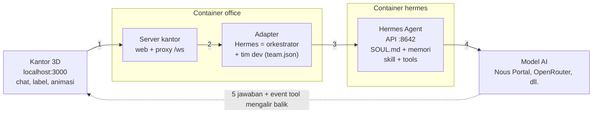

# Panduan Agentic Digital Office

Terakhir diperbarui: 18 Oktober 2026 · versi online: [Panduan Agentic Digital Office](https://claude.ai/code/artifact/09eed842-887e-4dfe-9beb-5de84818f751)

## Ringkasan

Agentic Digital Office adalah tim agen AI (dipimpin orkestrator Hermes, anggotanya Anda buat sendiri) yang tampil sebagai karakter 3D di sebuah kantor virtual. Semuanya berjalan di Docker Desktop dari folder `D:\Coding\digital-agent-office`, dan hanya bisa dibuka dari komputer ini.

| Bagian | Isi | Alamat |
| --- | --- | --- |
| Container `office` | Kantor 3D (three.js) + adapter Hermes | http://localhost:3000 |
| Container `hermes` | Hermes Agent resmi dari Nous Research: otak agen, API, dashboard | Dashboard http://127.0.0.1:9119, API http://127.0.0.1:8642 |
| Volume `digital-agent-office_hermes-data` | Konfigurasi, login provider AI, memori, skill Hermes | (di dalam Docker) |
| Volume `digital-agent-office_office-data` | Riwayat chat tiap agen dan catatan pemakaian token di kantor | (di dalam Docker) |

Status per hari ini: semua komponen jalan dan agen sudah bisa menjawab serta memakai tools. Hermes tersambung ke Nous Portal dengan model gratis `poolside/laguna-s-2.1:free` (lihat [Memilih provider dan model AI](#memilih-provider-dan-model-ai)).

## Mulai cepat

| Mau | Caranya |
| --- | --- |
| Menyiapkan penjualan atau kampanye | Pilih proyek → klik **Hermes** → "Yui brainstorming ide kampanye, Daichi riset pesaing, Sakura tulis konten, Haruto susun skrip penjualan" → hasilnya tersimpan di `docs/` proyek |
| Rapat membahas project | **💬 Rapat** → isi topik, centang peserta (maks. 5), pilih jumlah putaran → **Mulai rapat**. Notulen masuk ke 📋 RINGKASAN (lihat [Rapat tim](#rapat-tim-rapat)) |
| Diskusi tanpa mengubah file | Pilih **📁 Pilih proyek…** (kosong) → klik **Hermes** → "Ajak Yui, Sakura, dan Daichi diskusi ide X, lalu rangkum dan beri rekomendasi" |
| Ngobrol dengan satu agen | Pilih agennya di kotak chat kiri bawah (select **Ke**), atau klik karakternya / namanya di header, lalu ketik pesan |
| Mengubah suasana kantor | Tombol **🕒 Waktu** (otomatis, pagi, siang, sore, malam) dan **☀ Cuaca** (cerah, berawan, hujan, badai, kabut) di header |
| Memindah atau menambah furnitur kantor | **🛠 Layout** → klik benda lalu seret (lihat [Mengatur layout kantor](#mengatur-layout-kantor--layout)) |

**Riwayat dan ringkasan.** Riwayat chat tiap agen disimpan di server (volume `office-data`), termasuk pesan yang baru dikirim dan balasan yang gagal, jadi tetap ada setelah halaman di-refresh. Kalau di-refresh saat agen masih bekerja, balasannya tetap masuk. Panel **📋 RINGKASAN** di kanan atas berisi ringkasan singkat setiap kali agen selesai menjawab (siapa, kapan, tugasnya, inti jawabannya); klik salah satunya untuk membuka chat agen itu langsung di pesan yang diringkas (pesan dan pertanyaannya disorot), atau klik **–** untuk menyembunyikan panel. Centang kotak di setiap ringkasan setelah Anda membacanya (bertanda **Dibaca** dan tampil redup; yang belum bertanda **Baru**). Hanya Anda yang menandai, jumlah yang belum dibaca tampil di judul panel, dan **Tampilkan yang belum dibaca saja** menyaring daftarnya. Tanda baca disimpan di server, jadi tetap ada setelah refresh atau di tab lain.

Agen diminta menjawab singkat (maksimal sekitar 5 kalimat atau 5 poin), kecuali Anda meminta detail. Model gratis kadang tetap menjawab panjang; model yang lebih kuat lebih patuh.

## Instalasi dari awal (laptop/PC baru)

Yang dibutuhkan: Windows 10/11 dengan WSL2, Docker Desktop, Git, koneksi internet, dan ruang disk kosong sekitar 8 GB (image Hermes sekitar 4,5 GB). Hermes dan kantor berjalan di dalam container, jadi tidak perlu memasang Hermes atau Node.js.

1. **Pasang WSL2.** Buka PowerShell sebagai administrator, jalankan `wsl --install`, lalu restart komputer.
2. **Pasang Docker Desktop** dari docker.com. Di Settings → General, pastikan "Use the WSL 2 based engine" aktif, lalu biarkan Docker Desktop menyala.
3. **Pasang Git for Windows** dari git-scm.com (pilihan bawaan sudah cukup).
4. **Ambil proyeknya.** Buka PowerShell di folder tempat menyimpan proyek (misalnya `D:\Coding`), lalu jalankan `git clone https://github.com/Hiraito23/digital-agent-office.git` dan `cd digital-agent-office`.
5. **Buat file `.env`** dari contohnya dengan `copy .env.example .env`, lalu buka `.env` di Notepad dan isi:
    - `API_SERVER_KEY`: kunci acak. Buat di PowerShell dengan `[guid]::NewGuid().ToString('N') + [guid]::NewGuid().ToString('N')`, lalu tempel hasilnya.
    - `DASH_USER`: biarkan `admin`.
    - `DASH_PASS`: password dashboard pilihan Anda (juga dipakai panel ⚙ Agen untuk menyimpan SOUL.md).
    - `OFFICE_NAME` (opsional): nama kantor di header, tab browser, dan papan neon di dinding. Kosongkan untuk "Agentic Digital Office".
    - `PROJECTS_DIR`: folder berisi proyek yang boleh dikerjakan agen, misalnya `D:/Coding` (lihat bagian Mengerjakan proyek). Kosongkan untuk memakai folder `projects/` di repo ini.

    File ini rahasia dan tidak ikut ke GitHub.
6. **(Opsional) Salin musik.** File MP3 tidak ada di GitHub. Kalau ingin ada musik, salin `asuka-city.mp3` dan `littleroot-town.mp3` ke `office\public\audio\` sebelum langkah 7 (untuk lagu lain lihat `office/public/audio/README.md`). Tanpa ini kantor tetap jalan, hanya tanpa musik.
7. **Nyalakan.** Di folder proyek jalankan `docker compose up -d --build`. Pertama kali butuh beberapa menit karena mengunduh image Hermes.
8. **Sambungkan provider AI (wajib, sekali per komputer).** Ikuti [Memilih provider dan model AI](#memilih-provider-dan-model-ai) di bawah: login/isi API key, pilih model, salin `API_SERVER_KEY` ke Hermes, lalu restart.
9. **Buka kantor** di http://localhost:3000 (sebaiknya di Microsoft Edge agar suara Indonesia tersedia) dan **dashboard Hermes** di http://127.0.0.1:9119 (login `admin` + `DASH_PASS`).
10. **Uji.** Klik karakter Hermes dan kirim "Halo, perkenalkan timmu". Kalau muncul "Provider authentication failed", lihat bagian Pemecahan masalah.

Data yang ikut dari GitHub: tim agen beserta soul, tampilan, dan suaranya (`config/team.json`, `config/people.json`), skill tim (`config/skills/`), dan layout furnitur bila Anda sudah mengubahnya (`config/layout.json`). Yang **tidak** ikut dan dibuat ulang di tiap komputer: `.env`, API key model, SOUL.md, memori, dan riwayat chat (semuanya tersimpan di volume Docker komputer itu).

Mengambil pembaruan terbaru: `git pull`, lalu `docker compose up -d --build`.

### Memilih provider dan model AI

Hermes butuh satu provider AI. Semua perintah di bawah dijalankan di PowerShell, di folder proyek.

1. **Login atau isi API key.** Jalankan `docker exec -it hermes hermes model`, lalu pilih provider:
    - **Nous Portal** (login lewat browser, ada model gratis). Saldo $0 hanya bisa memakai model berakhiran `:free`; model berbayar seperti Claude Opus akan ditolak dengan pesan "Billing or credits exhausted".
    - **OpenRouter, Anthropic, OpenAI, Gemini, dll.** dengan API key dari situs masing-masing (berbayar sesuai pemakaian).
2. **Pilih model** di menu yang sama. Untuk Nous Portal gratis, `poolside/laguna-s-2.1:free` sudah teruji bisa berbahasa Indonesia dan memakai tools. Bisa juga diatur langsung:
    ```
    docker exec hermes hermes config set model.provider nous
    docker exec hermes hermes config set model.default "poolside/laguna-s-2.1:free"
    ```
3. **Salin `API_SERVER_KEY` ke Hermes.** Setelah wizard `hermes setup`/`hermes model`, Hermes membaca kunci API server dari file `.env` miliknya sendiri. Tanpa langkah ini port 8642 tidak menyala dan kantor tidak bisa bicara dengan Hermes:
    ```
    docker exec hermes sh -c 'grep -q "^API_SERVER_KEY=" /opt/data/.env || printf "\nAPI_SERVER_KEY=%s\n" "$API_SERVER_KEY" >> /opt/data/.env'
    ```
4. **Aktifkan model per agen.** Tanpa ini Hermes mengabaikan model yang dipilih di panel ⚙ Agen dan semua agen memakai model default:
    ```
    docker exec hermes hermes config set platforms.api_server.extra.direct_model_requests true
    ```
5. **Restart dan uji:** `docker compose restart hermes`, tunggu sekitar 20 detik, lalu kirim pesan ke agen di kantor.

Mengecek status login: `docker exec hermes hermes auth list`. Mengganti model default nanti cukup ulangi langkah 2 lalu `docker compose restart hermes`.

### Memakai model berbayar

Model per agen dipilih dari dropdown di panel ⚙ Agen (lihat [Model AI per agen](#model-ai-per-agen)). Yang perlu disiapkan hanya akses ke model berbayarnya, lewat salah satu jalur:

**Jalur A: kredit Nous Portal** (paling sederhana, model Claude ada di daftarnya).

1. Isi kredit atau berlangganan di https://portal.nousresearch.com.
2. Hermes mencatat kredensial yang ditolak karena saldo habis sebagai *exhausted* dengan masa tunggu. Hapus statusnya supaya langsung dipakai lagi:
    ```
    docker exec hermes hermes auth reset nous
    ```
3. Cek statusnya dengan `docker exec hermes hermes auth list`, lalu pilih model berbayar di dropdown **Model AI** agen. Tidak perlu restart. Kalau masih "Billing or credits exhausted", cek saldo di portal, lalu coba `docker exec hermes hermes auth refresh nous`.

**Jalur B: API key Anthropic langsung.** Langganan Claude (Pro/Max) dan API Anthropic ditagih terpisah: Hermes memanggil model lewat API, jadi yang dipakai adalah saldo di console.anthropic.com, bukan langganan. Login OAuth langganan di aplikasi pihak ketiga sebaiknya dihindari karena bisa melanggar ketentuan Anthropic; periksa ketentuan terbarunya.

1. Isi kredit di console.anthropic.com (**Billing**) dan buat key di **API Keys**.
2. Daftarkan key di terminal (key diketik tersembunyi, jangan ditempel ke chat):
    ```
    docker exec -it hermes hermes auth add anthropic --type api-key
    ```
3. Cek dengan `docker exec hermes hermes auth list`. Dropdown **Model AI** lalu punya grup **Anthropic** (daftar model di-cache 5 menit, refresh halaman bila belum muncul). Model provider selain default tersimpan dengan format `provider::model`.

Perintah di atas tidak mengubah model default Hermes. Hermes sebagai ketua tim dan agen yang kolom modelnya kosong tetap memakai model default; ubah dengan `docker exec hermes hermes config set model.default "<model>"` lalu `docker compose restart hermes`.

**Mengatur biaya.** Setiap balasan membawa sekitar 12.000 token input (prompt sistem, tools, dan riwayat), jadi model default yang mahal cepat menguras saldo.

- Pasang model murah atau gratis sebagai default.
- Beri model kuat hanya ke agen yang butuh penalaran berat (misalnya Kenji untuk riset saham dan Akane untuk keamanan).
- Pantau di [📊 Pemakaian](#pemakaian-token--pemakaian). Panel itu hanya menampilkan token; saldo asli dilihat di portal Nous atau console Anthropic.
- Hindari **💬 Rapat** dengan banyak putaran dan peserta untuk topik sepele: setiap giliran bicara dihitung sebagai satu balasan penuh.

### Perintah harian

| Perlu | Perintah (di folder proyek) |
| --- | --- |
| Menyalakan | `docker compose up -d` |
| Mematikan (data tetap aman) | `docker compose down` |
| Melihat log | `docker compose logs -f` |
| Setelah mengganti provider, API key, atau model | `docker compose restart hermes` |
| Menambah, mengubah, menghapus agen | panel **⚙ Agen** di kantor (langsung berlaku) |
| Setelah mengubah apa pun di `office/` (tampilan, server, adapter) | `docker compose up -d --build office`, lalu refresh browser |
| Mengambil pembaruan dari GitHub | `git pull`, lalu `docker compose up -d --build` |

Kedua container memakai `restart: unless-stopped`, jadi ikut menyala sendiri setiap kali Docker Desktop berjalan.

## Cara kerja agen

Setiap pesan dari kantor diteruskan ke mesin Hermes, yang meminta jawaban dari model AI di provider pilihan Anda dan menjalankan tools bila perlu. Jawabannya mengalir balik sedikit demi sedikit, dan itulah yang menggerakkan karakter.



1. **Anda mengetik di kantor** (klik karakter, kirim pesan). Browser mengirimnya lewat WebSocket ke server kantor.
2. **Adapter menentukan siapa yang menjawab.** Pesan ke Hermes diproses dengan kemampuan orkestrator; pesan ke anggota tim (Haruto, Kenji, Sakura, Yui, Takumi, Akane, Daichi) memakai persona mereka dari `team.json`, ditambah folder proyek aktif dan aturan git.
3. **Adapter memanggil Hermes Agent** (`/v1/chat/completions` di port 8642). Hermes menambahkan identitas `SOUL.md`, memori, dan skill, lalu menjalankan tools (terminal, file, web, ...) di container `hermes`.
4. **Hermes meminta model AI** di provider yang Anda pilih lewat `hermes model`. Di sinilah biaya token terjadi (gratis untuk model `:free`).
5. **Jawaban mengalir balik** sebagai event `delta` (sedang menulis) lalu `final` (selesai), ditambah event tool dan permintaan persetujuan. Kantor memakai event ini untuk: karakter berjalan ke meja dan duduk mengetik, menampilkan gelembung kata dan ikon tool, menampilkan balasan di kotak chat (tidak dibacakan), mencatat di tab Log, lalu kembali bersantai setelah selesai.

### Hermes sebagai orkestrator

Hermes menyuruh anggota tim lewat **server MCP `office-team`**, yang dijalankan kantor sendiri dan **didaftarkan otomatis ke Hermes** saat kantor menyala (tanpa langkah manual di clone baru). Alatnya: `team_list` (daftar anggota dan id-nya), `team_delegate` (memberi tugas ke seorang anggota dan menunggu hasilnya), `team_result` (mengambil hasil tugas yang belum selesai), dan `team_context` (membaca percakapan terbaru seorang anggota). Jadi cukup beri Hermes tujuan besar, misalnya "siapkan peluncuran produk kopi". Hermes membaginya ke Yui (ide dan strategi), Daichi (riset pasar), Sakura (konten), Haruto (penjualan), dan Takumi (periksa kualitas materi), lalu merangkum hasilnya. Setiap delegasi dikerjakan oleh agen kantor yang sebenarnya, persis seperti kalau Anda chat dengannya: ia terlihat bekerja di kantor (progress bar di bawah namanya), dan tugas serta jawabannya tersimpan di chat agen itu dan di Ringkasan. Kalau agennya belum selesai dalam 100 detik, Hermes mendapat `task_id` dan mengambil hasilnya nanti dengan `team_result`.

**Perintah langsung ke agen.** Karena model yang lemah kadang tidak memanggil tool (dan hanya mengaku sudah mendelegasikan), pesan ke Hermes yang berbentuk perintah ke agen bernama, misalnya "suruh Sakura pilih warna ...", "minta Haruto dan Sakura untuk membuat ...", "tugaskan Takumi ...", langsung diteruskan oleh kantor ke agen-agen itu tanpa melewati model Hermes. Hermes menjawab dengan hasil tiap agen. Pesan lain (pertanyaan, diskusi, tujuan besar) tetap diproses Hermes seperti biasa.

Agen yang direkrut Hermes saat chat hanya hidup sampai container `office` restart. Agen tetap dibuat lewat panel **⚙ Agen** (tersimpan di `config/team.json`).

## Melatih kepribadian (soul)

Agen tidak "dilatih" ulang seperti model AI. Kepribadiannya dibentuk oleh teks instruksi yang dibaca setiap kali ia menjawab, plus memori yang tumbuh dari percakapan. Ada tiga lapisan, dari yang paling umum ke paling khusus:

| Lapisan | Berlaku untuk | Tempat | Isi yang cocok |
| --- | --- | --- | --- |
| `SOUL.md` | Semua agen (satu mesin Hermes) | Volume `hermes-data` → `/opt/data/SOUL.md` | Nilai dan gaya dasar seluruh kantor: bahasa, nada, kejujuran, cara menangani ketidakpastian |
| Instruksi per agen | Satu agen | Panel ⚙ Agen → Instruksi dan Batasan (`config/team.json`) | Peran, keahlian, gaya bicara khas, batasan |
| Memori | Tumbuh sendiri | Memori bawaan Hermes + riwayat chat di volume `office-data` | Fakta tentang Anda dan proyek, preferensi, hasil kerja sebelumnya |

### Mengubah SOUL.md

Cara termudah: panel **⚙ Agen** → tab **Soul**, edit, lalu **Simpan SOUL.md**. Kantor menyimpannya lewat API resmi dashboard Hermes.

Menurut [dokumentasi Hermes](https://hermes-agent.nousresearch.com/docs/user-guide/features/personality), `SOUL.md` adalah identitas utama agen dan menempati posisi pertama di system prompt. Isinya sebaiknya panduan yang tahan lama (nada, keterusterangan, hal yang dihindari), bukan detail proyek.

Cara manual (alternatif):

1. Salin keluar: `docker cp hermes:/opt/data/SOUL.md .\SOUL.md`
2. Edit di VS Code atau Notepad.
3. Salin kembali: `docker cp .\SOUL.md hermes:/opt/data/SOUL.md`, lalu `docker compose restart hermes`.

Contoh isi singkat: "Kamu bagian dari tim Agentic Digital Office. Selalu jawab dalam Bahasa Indonesia yang santai tapi sopan. Akui kalau tidak tahu, jangan mengarang angka. Utamakan jawaban ringkas dengan langkah yang bisa langsung dikerjakan."

### Menulis persona per agen

Isi kolom **Instruksi / kepribadian** dan **Batasan** di panel ⚙ Agen. Resep persona yang efektif:

- **Siapa dan untuk apa:** "Kamu adalah Takumi, QA Engineer yang menguji aplikasi web React + NestJS."
- **Cara kerja:** langkah yang selalu dia ikuti, misalnya "selalu tulis langkah reproduksi dan hasil yang diharapkan".
- **Gaya bicara:** satu sampai dua ciri khas, misalnya "suka memakai perumpamaan" atau "to the point, pakai poin-poin".
- **Batasan:** apa yang tidak boleh dilakukan, misalnya "jangan menghapus file tanpa konfirmasi".
- **Format hasil:** misalnya "akhiri dengan ringkasan tiga poin".

Id agen tidak bisa diubah setelah dibuat. Riwayat chat, tampilan, dan suara terikat ke id itu.

### Memperkuat lewat pemakaian

- Koreksi langsung di chat ("lain kali pakai format tabel"). Hermes menyimpan hal penting ke memori.
- Kalau ada pola kerja yang terus diulang, jadikan skill (lihat bagian berikut) agar konsisten.
- Personality sementara tersedia lewat perintah `/personality` di chat Hermes (misalnya `concise`, `teacher`). Ini hanya lapisan sesi dan tidak mengubah `SOUL.md`.

## Kantor dan kegiatan agen

Kantor adalah **gedung tiga lantai** (tiap lantai berukuran sama, 26 x 10 tile) di tengah taman, dengan menara **lift** kaca di sisi barat. Tiap ruang punya tembok dan pintu sendiri (dinding bawah solid, bagian atas kaca):

| Lantai | Isi |
| --- | --- |
| **Lantai 1** | **Lobby** di sisi depan (portal Hermes, area tunggu, gerbang masuk), lalu di belakangnya **Kantin** (konter kopi, dispenser, meja makan, akuarium) dan **Ruang Game** (arcade, dua meja ping-pong, bean bag), masing-masing dengan pintu ke lobby |
| **Lantai 2** | Lorong dengan **12 ruang pribadi**: tiap agen punya ruangan sendiri berisi meja kerja, lemari, dan tanaman. Nama agen tampil di papan atas pintunya |
| **Lantai 3** | **Ruang Rapat** (meja rapat, whiteboard, rak buku), **Ruang Server** (rak server dan kristal), dan teras terbuka |

**Satu agen satu ruangan:** Hermes mendapat ruangan pertama, lalu anggota tim diurutkan menurut id. Begitu mendapat tugas (dari Anda atau dari Hermes), agen **berlari ke ruangannya** (naik lift bila perlu), duduk, dan mengetik; setelah selesai ia tetap duduk minimal 3 detik (agar terlihat bekerja walau tugasnya singkat), lalu berdiri dan kembali bersantai atau mengobrol di lobi, kantin, atau lorong. Layout bawaan punya 12 meja. Kalau agen lebih banyak dari meja, tambah meja lewat **🛠 Layout**. Saat rapat, semua peserta naik lift ke Ruang Rapat di lantai 3.

**Tab lantai** di bagian atas layar menampilkan satu lantai sekali waktu: mulai dari **Lantai 1** (lobby, game, kantin), lalu pilih **Lantai 2** (ruang agen) atau **Lantai 3** (rapat dan server). Lantai lain tetap terlihat samar (bawaan **opasitas 20%**, bisa diatur di **⚙ Pengaturan** > *Opasitas lantai lain*, 0 sampai 100%). Tab **Semua** menampilkan ketiga lantai penuh. Kamera meluncur halus ke lantai yang dipilih. Agen di lantai lain yang sedang mengerjakan tugas atau berbicara tetap punya name tag lengkap dengan **bar progres**, bertanda *Lantai N* dan berbingkai putus-putus. Kalau 🎥 Sorot menyorot rapat atau obrolan di lantai lain, tab berpindah sementara ke lantai itu lalu kembali setelah selesai.

Saat santai, agen memakai properti kantor dan ikon kegiatannya tampil di label nama:

| Properti | Kegiatan | Ikon |
| --- | --- | --- |
| Sofa dan bean bag di area santai | Duduk bersantai | 🛋 |
| Pantry (mesin kopi, microwave) | Minum kopi | ☕ |
| Akuarium | Melihat ikan | 🐟 |
| Rak buku | Membaca | 📖 |
| Whiteboard dengan sticky note | Menulis | ✍ |
| Meja rapat (4 kursi) | Rapat | 💬 |
| Rak server | Cek server | 🖥 |
| Dua mesin arcade | Main game | 🎮 |
| Meja ping-pong | Main ping-pong | 🏓 |

Dekorasi lain: karpet, meja kopi, papan neon, jam dinding, dan tanaman besar di sudut. Satu properti hanya dipakai satu agen dalam satu waktu; kegiatan berlangsung sekitar 9 sampai 18 detik. Posisi semua furnitur ini bisa diubah lewat **🛠 Layout**.

## Kotak chat (gaya MMORPG)

Kotak chat ada di **kiri bawah**, seperti di game MMORPG. Tampilannya memakai bingkai emas-perunggu. Susunan layar: judul dan tombol di header (kanan atas), panel **👥 TIM** di kiri (daftar semua agen dengan titik status; klik untuk memilih agen), **📋 RINGKASAN** di kanan atas, dan **PERSETUJUAN** di kanan bawah. Semua panel mengikuti tinggi header yang sebenarnya, jadi tidak saling menutupi walau header membungkus jadi beberapa baris di layar sempit.

| Bagian | Fungsi |
| --- | --- |
| **Ke** (select) | Memilih agen yang diajak bicara. Berganti agen langsung memuat riwayatnya. Di kolom pesan, tekan **Tab** (atau **Shift+Tab**) untuk berpindah agen seperti mengganti target bisik di MMO |
| Kolom pesan | Ketik pesan atau tugas. **Enter** mengirim, **Shift+Enter** baris baru. Tekan **Enter** di mana saja untuk langsung menulis |
| Tab **💬 Pesan** | Percakapan dengan agen yang dipilih dalam bentuk **bubble chat**: pesan Anda di kanan (biru muda), balasan agen di kiri dengan avatar berwarna (tiap agen punya warna sendiri), lengkap dengan jam |
| Tab **📢 Kantor** | Obrolan antar agen saat santai, juga sebagai bubble (kedua pembicara bergantian di kiri dan kanan; topik dari internet menampilkan 📰/📚 sumbernya), dan balasan dari agen yang sedang tidak Anda ajak bicara sebagai "bisikan" (klik bubble-nya untuk membuka percakapan). Angka merah di tab menunjukkan pesan baru. **Anda juga bisa menulis di sini**: lihat di bawah |
| Tab **📜 Log** | Catatan sistem (tetap berupa baris teks): tool yang dipakai agen, persetujuan, proyek aktif, koneksi |
| Tombol **–** | Mengecilkan kotak chat jadi hanya baris tab (diingat per browser) |
| Tepi atas kotak | **Tarik ke atas atau bawah** untuk mengatur tinggi kotak chat (ada garis penanda di tepinya). Klik dua kali tepi itu untuk kembali ke tinggi awal. Tinggi diingat per browser |

**Menulis di tab Kantor.** Tab ini adalah saluran obrolan kantor: kalau Anda menulis di sini, **satu agen pasti menjawab** (select "Ke" disembunyikan karena penerimanya bukan satu orang). Agen yang menjawab dipilih begini: yang **Anda sebut namanya** ("Kenji, ...", "@Sakura ..."); kalau tidak ada nama, agen yang terakhir bicara di tab ini (biar nyambung); kalau tidak ada, agen acak yang sedang tidak bekerja. Ia membalas dalam satu sampai tiga kalimat santai sesuai kepribadiannya dan mengetahui beberapa baris terakhir obrolan kantor. Ini hanya ngobrol: agen tidak menjalankan tool atau membuat file, dan percakapannya tidak masuk ke riwayat chat pribadi agen. Setiap pesan memakai satu panggilan model (tercatat di 📊 Pemakaian). Untuk memberi tugas, pakai tab **💬 Pesan**.

Klik di ringkasan (📋 RINGKASAN) membuka percakapan agen itu dan menyorot balasannya, seperti sebelumnya. Kotak chat selalu punya penerima: Hermes secara bawaan.

## Obrolan antar agen saat santai

Agar kantor tidak kaku, dua agen yang sedang santai (berdiri atau berjalan di aula, tidak sedang bekerja atau rapat) kadang saling mendekat, berhadapan, lalu bergantian bicara lewat gelembung kata (3 sampai 5 kalimat), dengan jeda 15 sampai 30 detik antar obrolan. Topiknya sangat beragam (200+ obrolan siap pakai, dan tidak diulang dalam waktu dekat): kuliner, wisata, musik, film dan buku, budaya developer, kebiasaan sehat, nostalgia, fakta menarik, tebak-tebakan, "pilih mana", kehidupan kantor, candaan khas peran (PM dengan developer, QA dengan developer, security dengan developer, dan seterusnya), obrolan tentang cuaca, waktu, dan hari dalam seminggu, serta **fakta menarik dari internet** dan **berita yang sedang tren** (lihat di bawah). Setiap kalimat juga tercatat di tab **📢 Kantor**.

**Obrolan berita.** Kantor mengambil headline terbaru dari feed publik Google News Indonesia (teknologi, sains, olahraga, hiburan, bisnis) setiap 30 menit, lewat server kantor (`/api/news`), tanpa mengirim data apa pun tentang Anda. Sekitar satu dari lima obrolan membahas satu headline ("Eh Sakura, udah baca berita ini? ..."), dengan tanggapan yang sesuai topiknya. Headline tentang kecelakaan, bencana, kriminal, politik, kematian, dan sejenisnya disaring supaya obrolan tetap ringan. Kalau tidak ada internet, agen memakai topik biasa. Daftar kata yang disaring ada di `BLOCKED` di `office/server/news.js`.

**Aktivitas dan sapaan.** Agen yang sedang santai tidak hanya berjalan dan mengobrol:
- **Saling menyapa.** Dua agen yang berpapasan berhenti sebentar, saling menoleh, **melambaikan tangan**, dan menyapa lewat bubble ("Hai, Kenji! 👋", "Selamat pagi!", "Masih lembur? 🌙" sesuai waktu). Pasangan yang sama baru menyapa lagi setelah sekitar satu menit. Sebelum mengobrol panjang mereka juga melambai dulu.
- **Tidur** (💤) di sofa atau bean bag, kadang lebih lama, dan **meregangkan badan** saat bangun.
- **Membaca buku** (📖): duduk membaca di sofa atau bean bag, atau berdiri di rak buku sambil membalik halaman.
- **Makan** (🍙 🍩 🥪 🍜 🍪 🍌): makan camilan di pantry kopi, selain minum kopi.
- **Tos (high five) 🙌.** Setelah seorang agen selesai mengerjakan tugas dan berdiri dari mejanya, rekan yang sedang santai berjalan menghampiri, memujinya ("Kerja bagus, Sakura!"), dan mereka tos.
- **Pingpong berdua 🏓.** Agen yang mau main pingpong mengajak rekan yang sedang santai ("Main pingpong yuk!"); mereka berdiri di dua sisi meja. Tanpa rekan, ia memilih aktivitas lain.
- Tetap ada main arcade, pingpong, melihat akuarium, dan minum kopi. Agen yang punya tugas langsung ke komputernya, apa pun yang sedang dilakukan. Sapaan hanya berupa bubble; suara tidak dipakai untuk sapaan.

**Fakta menarik dari Wikipedia.** Supaya topiknya tidak itu-itu saja, kantor mengumpulkan fakta dari Wikipedia Indonesia sebanyak-banyaknya dan menyimpannya dalam kumpulan yang terus bertambah (disimpan di volume `office-data`, jadi tidak hilang saat restart). Saat pertama menyala server mengumpulkan sekitar 220 fakta dalam beberapa menit, lalu menambah tiap 30 menit, sampai maksimal 1.500. Sumbernya puluhan kategori (candi, hewan, planet, penemuan, rekor dunia, fenomena alam, teknologi, permainan video, makanan, tarian, gunung, pulau, dan seterusnya) beserta subkategorinya; kalimat pertama artikel diambil sebagai fakta. Biografi, desa/kecamatan, daftar, definisi matematika yang kering, serta topik sedih, kekerasan, atau politik dilewati, dan fakta yang mengandung kata seperti terbesar, tertua, endemik, rekor, atau satu-satunya diprioritaskan. Sekitar 30% obrolan memakai fakta ini ("Tahu nggak, Sakura? ..."), dengan 📚 Wikipedia di bubble-nya. Setelah terkumpul banyak, obrolan hampir tidak pernah mengulang. Cek jumlahnya di `http://localhost:3000/api/facts?limit=5`.

Obrolan ini tidak memanggil model AI (kalimat dan polanya ada di `office/public/js/world/chatter.js`; fakta dan berita diambil dari internet), jadi tidak memakai token dan tidak mengubah riwayat chat agen. Obrolan berhenti sendiri bila salah satu agen mendapat tugas atau ada rapat. Tambah topik baru dengan menambah baris di `GENERIC`, `BY_ROLE`, `WEATHER`, atau `PERIOD` di berkas itu. Animasi hanya berjalan saat tab browser terlihat.

## Tombol Pengaturan (⚙)

Header hanya berisi nama kantor, tombol **⚙ Pengaturan**, dan status koneksi. Semua menu ada di pop-up Pengaturan, dikelompokkan:

| Kelompok | Isi |
| --- | --- |
| **Kerja** | 📁 Pilih proyek, 💬 Rapat, 📂 Berkas, 📊 Pemakaian, ⚙ Agen, 🛠 Layout |
| **Suasana** | 🕒 Waktu, ☀ Cuaca, 🎥 Sorot, ▦ Pixel/HD, dan penggeser **Opasitas lantai lain** |
| **Suara** | 🔊 Suara, ♪ Musik |

Pop-up menutup sendiri saat Anda mengklik di luarnya, menekan Esc, atau membuka sebuah panel (Rapat, Berkas, Pemakaian, Agen, Layout). Tombol suasana dan suara membiarkannya terbuka supaya bisa diatur berurutan. Tata letak panel di layar: kiri atas **Tim**, kiri bawah **kotak chat**, kanan atas **Ringkasan**, kanan tengah **Jukebox** (saat dibuka), kanan bawah **Persetujuan**, dan **tab lantai** di tengah atas; panel samping selalu selebar sama dan menyempit di layar kecil.

## Waktu dan cuaca

Tombol **🕒 Waktu** dan **☀ Cuaca** di header mengubah suasana kantor. Tombol **🎥 Sorot** membuat kamera menyorot agen yang sedang berinteraksi (rapat di Ruang Rapat, dua agen yang mengobrol, atau tos) dengan transisi halus, lalu kembali ke posisi Anda setelah selesai; menggeser atau memutar kamera sendiri menghentikan sorotan itu (klik lagi untuk mematikan: **🎥 Manual**). Tiap klik berpindah ke pilihan berikutnya, dan pilihannya diingat per browser.

| Tombol | Pilihan | Efek |
| --- | --- | --- |
| 🕒 Waktu | **Otomatis** (mengikuti jam komputer; labelnya menampilkan bagian hari saat ini) | Langit, matahari/bulan, dan cahaya bergeser mulus sepanjang hari |
| | **Pagi** (±07.15) | Cahaya hangat keemasan, langit biru muda |
| | **Siang** (±12.30, mode terang) | Terang penuh, bayangan pendek |
| | **Sore** (±17.30) | Cahaya jingga, bayangan panjang, langit senja |
| | **Malam** (±22.00, mode malam) | Langit gelap berbintang, bulan, lampu taman dan jendela menyala |
| ☀ Cuaca | **Cerah**, **Berawan**, **Hujan**, **Badai** (hujan deras + kilat), **Kabut** | Awan bergerak, hujan turun, cahaya meredup dan langit mengabu, kabut menebal. Cuaca bisa digabung dengan waktu mana pun |

Berpindah waktu secara manual memutar jam dengan cepat (seperti time-lapse) menuju waktu tujuan. Pada mode Otomatis perpindahan mengikuti jam asli, jadi pagi, sore, dan malam terjadi sesuai jam komputer.

## Progress bar tugas

Saat agen mengerjakan tugas, di **bawah label namanya** muncul progress bar dengan keterangan waktu berjalan dan tool yang sedang dipakai (mis. "0:42 · terminal"). Bar-nya adalah **perkiraan**, karena model AI tidak melaporkan persentase asli: bar naik perlahan seiring waktu dan melompat setiap agen memakai tool, tetapi berhenti di sekitar 94% sampai tugas benar-benar selesai. Setelah selesai bar penuh berwarna hijau ("Selesai ✓ 1:05") dan hilang beberapa detik kemudian; kalau gagal menjadi merah ("Gagal ✕"). Agen yang sedang bekerja juga ditandai titik kuning di nama header dan bingkai label kuning. Agen yang didelegasikan Hermes mendapat bar sendiri.

## Mengatur layout kantor (🛠 Layout)

Mode edit seperti *build mode* di The Sims: klik **🛠 Layout** di header untuk memindah, memutar, menambah, atau menghapus furnitur. Perubahan tersimpan otomatis dan tetap ada setelah restart.

| Mau | Caranya |
| --- | --- |
| Memindah benda | Klik benda, lalu seret ke tempat baru dan lepas. Benda menempel ke grid, dinding, dan benda di sebelahnya |
| Memutar | Pilih benda lalu tekan **R** (atau tombol **↻ Putar**); tiap tekan memutar 90° |
| Menambah benda | Klik jenisnya di **Tambah benda**, gerakkan kursor ke lantai (benda mengikuti kursor), lalu **klik** untuk menaruh. **Esc** membatalkan |
| Menggandakan | Pilih benda lalu **D** (atau **⧉ Gandakan**), lalu klik untuk menaruh salinannya |
| Mengganti warna atau varian | Pilih benda lalu **🎨 Varian** (bean bag, mesin arcade, dan barang pribadi di meja kerja) |
| Menghapus | Pilih benda lalu **Del** (atau **🗑 Hapus**) |
| Urungkan / ulangi | **Ctrl+Z** / **Ctrl+Y** (atau tombol **↶ Urungkan** / **↷ Ulangi**) |
| Memilih lantai yang diedit | Di panel **Lantai yang diedit** pilih Lantai 1, 2, atau 3; benda baru ditaruh di lantai itu |
| Mengatur kamera | Seret lantai kosong untuk memutar, klik kanan + seret untuk menggeser, roda mouse untuk zoom. Seret di atas benda berarti memindah benda |
| Kembali ke tata letak awal | **Kembalikan ke bawaan** (bisa diurungkan dengan Ctrl+Z) |
| Selesai | **✓ Selesai**, tombol ✕, atau klik **🛠 Layout** lagi |

**Hijau atau merah.** Selama benda dipegang, jejaknya di lantai berwarna hijau kalau tempatnya bebas dan merah kalau terhalang: di luar lantai kantor, menutup jalan masuk atau lingkaran panggil di lobi, atau menimpa benda lain (karpet boleh berada di bawah benda lain). Alasannya tampil di bagian atas panel. Benda yang dilepas di tempat merah kembali ke posisi semula.

**Yang ikut berpindah.** Titik duduk agen mengikuti bendanya: sofa, bean bag, pantry, akuarium, rak buku, mesin arcade, meja ping-pong, rak server, dan kursi meja rapat. Agen yang sedang santai langsung memakai posisi baru, dan rapat memakai kursi di meja rapat di mana pun ia berada. **Meja kerja** adalah tempat duduk milik agen: meja pertama di daftar milik Hermes, dan seterusnya (urutan sama dengan agen). Memindah meja memindahkan kursinya, dan agen yang sedang duduk berjalan ke tempat barunya.

**Menambah agen.** Setiap agen butuh satu meja. Kalau agen lebih banyak daripada meja, sisanya otomatis mendapat meja terbuka di aula (seperti sebelumnya). Tambah meja kerja dari katalog kalau ingin menempatkannya sendiri.

Batas dan catatan:

- Yang bisa diubah hanya furnitur. Ukuran lantai dan zona (warna lantai dan papan nama) tetap, diatur di `OFFICE` dan `ROOMS` di `office/layout.js`. Layout yang tersimpan untuk denah lama (versi lebih rendah) otomatis diabaikan dan diganti layout bawaan.
- Hanya ada satu meja rapat; tombolnya nonaktif selama sudah ada satu. Rapat memakai maksimal 5 kursi/posisi di meja itu dan selalu dihitung di Ruang Rapat.
- Whiteboard, papan neon, jam dinding, jendela, lampu, taman, dan lingkaran panggil adalah bagian bangunan dan tidak bisa dipindah.
- Layout disimpan di `config/layout.json` (ikut ke GitHub seperti `team.json`; file ini baru ada setelah Anda mengubah sesuatu). Tab browser lain baru menampilkan perubahan setelah di-refresh.
- Agen berjalan lurus dari koridor ke tujuannya tanpa mencari jalan memutar, jadi jangan menutup koridor dengan terlalu banyak furnitur.

## Mengerjakan proyek (📁 Proyek)

Agen bisa membaca dan menulis kode di proyek Anda. Folder `PROJECTS_DIR` di `.env` (misalnya `D:/Coding`) di-mount ke container Hermes sebagai `/workspace`.

1. Klik tombol **📁 Pilih proyek…** di header untuk membuka penjelajah folder. Jelajahi folder di bawah `PROJECTS_DIR`, lalu klik **Pilih** pada sebuah folder (atau **✔ Pilih folder ini**) untuk menjadikannya proyek aktif; folder apa pun boleh, tidak harus repo git. Repo git juga muncul sebagai pintasan **Repo git cepat**, lengkap dengan branch aktifnya. Aturan git di bawah hanya diberikan kalau folder yang dipilih adalah repo git. Folder di luar `PROJECTS_DIR` tidak terjangkau: ubah `PROJECTS_DIR` di `.env` lalu jalankan ulang `docker compose up -d`. Daftar repo git: folder di `PROJECTS_DIR` yang punya git, plus repo git satu tingkat di bawahnya (misalnya `Kalla/oase-tanjung`), lengkap dengan branch aktifnya. 
2. Beri tugas ke Hermes atau langsung ke agen, misalnya "Tambahkan halaman daftar pelanggan sesuai struktur folder yang ada". Semua agen, termasuk yang didelegasikan Hermes, otomatis tahu folder proyeknya.
3. Cek hasilnya di folder proyek dengan `git status`, `git log`, dan `git diff`.

Aturan yang selalu diberikan ke agen:

- Sebelum mengubah file, agen memeriksa branch. Kalau belum di branch yang diawali `agent/`, agen membuat **satu branch kerja bersama** untuk tugas itu (`agent/<nama-tugas>`), dan seluruh tim memakai branch itu.
- Tidak pernah commit atau push ke `main`, `master`, atau `develop`; tidak force push; tidak menghapus branch. Push hanya kalau Anda memintanya.
- Tidak membaca atau mengubah file rahasia (`.env`, kunci, kredensial).

Perlu diingat: dengan fitur ini agen bisa membuat, mengubah, dan menghapus file serta menjalankan perintah terminal di folder proyek. Aturan di atas adalah instruksi untuk agen, bukan pengaman teknis, jadi selalu tinjau perubahan sebelum di-merge. Pilih **📁 Pilih proyek…** (kosong) kalau tidak ingin agen bekerja di proyek mana pun.

## Rapat tim (💬 Rapat)

Untuk membahas sebuah project bersama beberapa agen sekaligus:

1. Pilih proyeknya di **📁 Proyek** (opsional, supaya rapat tahu konteksnya).
2. Klik **💬 Rapat** di header. Opsional: **unggah file `.md` atau `.txt`** di kotak *Dokumen untuk dibahas*; Hermes dan peserta membacanya (maks. 20.000 karakter) dan mendiskusikannya. Tanpa peserta, Hermes membahas dokumen itu sendiri. Isi **topik** (boleh kosong kalau ada dokumen), centang **peserta** (maksimal 5, sesuai kursi di Ruang Rapat), lalu pilih **putaran bicara** (1 sampai 3).
3. Klik **💬 Mulai rapat**. Hermes berjalan ke whiteboard, peserta duduk di kursi Ruang Rapat (ikon 💬 di label nama).
4. Hermes membuka rapat, lalu tiap peserta bicara bergiliran 2 sampai 4 kalimat dari sudut pandang perannya; gelembung kata dan transkrip di panel menunjukkan siapa yang sedang bicara.
5. Hermes menutup rapat dengan **notulen**: Ringkasan, Keputusan, dan Action item per orang. Notulen muncul di panel rapat dan di **📋 RINGKASAN**, **disimpan otomatis sebagai file `.md` di folder `rapat/`** (di `PROJECTS_DIR`, bisa dibuka di 📂 Berkas; berisi notulen, transkrip, dan dokumen yang dibahas), dan tersimpan di riwayat chat setiap peserta, jadi Anda bisa melanjutkan, misalnya ke Naruto: "kerjakan action item-mu dari rapat tadi".

Panel rapat punya dua tab: **💬 Obrolan** (isi diskusi per pembicara, langsung terisi selama rapat) dan **📝 Notulen** (ringkasan, keputusan, action item), jadi keduanya tidak berebut tempat. Rapat terakhir tetap bisa dibaca setelah halaman dimuat ulang. Tombol **Salin notulen** dan **Unduh .md** menyimpan notulen + transkrip. **■ Akhiri rapat** menghentikan rapat kapan saja. Selama rapat agen hanya berdiskusi, tidak mengubah file. Peserta yang modelnya tidak merespons selama 90 detik dilewati supaya rapat tetap berjalan. Lama rapat kira-kira (1 + peserta × putaran + 1) giliran × 5 sampai 15 detik.

### Melanjutkan hasil rapat dan melampirkan berkas ke chat

Hasil rapat tersimpan di folder `rapat/`. Ada tiga cara memakainya sebagai bahan kerja berikutnya:

1. **Tombol "➡ Lanjutkan ke Hermes (lembar kerja)"** di tab 📝 Notulen setelah rapat selesai: notulen terlampir ke chat Hermes dan kolom pesan terisi usulan tugas (ubah keputusan dan action item menjadi lembar kerja per agen, simpan di `rapat/`, lalu delegasikan). Edit dulu kalau perlu, lalu kirim.
2. **Tombol 📎 di kotak chat**: pilih berkas dari workspace (bagian *Hasil rapat terbaru* di atas, atau jelajahi folder). Isi berkas dikirim ke agen sebagai konteks; gelembung chat hanya menampilkan nama berkasnya. Batas: 5 berkas teks (.md, .txt, .json, .csv, kode, ...), maksimal 200 KB per berkas dan 40.000 karakter total. Lampiran berlaku untuk pesan ke satu agen (tab Pesan), bukan tab Kantor.
3. **Rapat lanjutan**: di formulir Rapat pilih *Lanjutkan dari rapat sebelumnya*; berkas hasil rapat itu menjadi dokumen yang dibahas di rapat baru.

## Tools Hermes (🧰 Tools dan PERSETUJUAN)

Semua agen memakai tools bawaan Hermes, yang berjalan di container `hermes`: terminal, operasi file (baca, tulis, patch, cari), eksekusi kode, browser otomatis, pencarian web, memori, skill, cron, todo, pembuatan gambar, analisis gambar, dan lainnya. Kantor menampilkan pemakaiannya:

- **Label nama**: saat agen memakai tool, ikon tool (misalnya 💻 terminal atau 📁 file) muncul di depan namanya dan gelembung kata menampilkan perintahnya.
- **Log** (tab ke-3 di kotak chat): setiap pemanggilan tool tercatat, misalnya "Takumi 💻 terminal: npm test".
- **Panel PERSETUJUAN** (kanan bawah): perintah yang dianggap berisiko oleh Hermes (misalnya menghapus folder) menunggu izin Anda. Pilih **Izinkan sekali**, **Izinkan sesi ini**, **Selalu izinkan**, atau **Tolak**. Agen menunggu sampai Anda menjawab.
- **⚙ Agen → 🧰 Tools**: daftar toolset Hermes beserta statusnya (aktif, nonaktif, atau perlu kunci API). Daftar ini hanya untuk dilihat. Untuk mengaktifkan, menonaktifkan, atau mengisi kunci API tool (misalnya pencarian web atau pembuatan gambar), buka dashboard Hermes di http://localhost:9119, lalu jalankan `docker compose restart hermes`.

## Mengelola agen (panel ⚙ Agen)

Semua pengelolaan agen dilakukan dari kantor, tanpa edit file dan tanpa restart. Klik **⚙ Agen** di kanan atas.

| Mau | Caranya |
| --- | --- |
| Tambah agen | Tab **Tim** → **＋ Agen baru**, isi nama, peran, instruksi, tampilan, suara → **Simpan**. Karakternya langsung muncul di kantor |
| Ubah agen | Tab **Tim** → **Ubah** di agen itu → ubah persona, tampilan, atau suara → **Simpan** |
| Ganti model AI agen | **Ubah** → dropdown **Model AI** → pilih → **Simpan**. Berlaku langsung tanpa restart |
| Hapus agen | **Ubah** → **Hapus agen** → konfirmasi. Riwayat chat agen itu ikut terhapus |
| Update soul (semua agen) | Tab **Soul** → edit → **Simpan SOUL.md** |
| Lihat tools yang tersedia | Tab **🧰 Tools** (pengaturannya di dashboard Hermes) |
| Pakai kostum | Form agen → **Kostum** → pilih dari Tema Pokémon, Tema Digimon, atau Tema Anime → **Simpan** |
| Pilih suara | Form agen → **Suara pilihan** → pilih dari daftar suara yang tersedia di browser (atau Otomatis) |
| Coba suara | Di form agen → **🔊 Tes suara** (pakai pengaturan yang belum disimpan) |

Hermes (orkestrator) tidak bisa dihapus; personanya diatur lewat SOUL.md, tapi tampilan dan suaranya bisa diubah. Data tersimpan di `config/team.json` dan `config/people.json`, jadi tetap ada setelah restart.

### Model AI per agen

Tiap agen bisa memakai model AI sendiri, supaya biaya token bisa diatur: model kuat untuk pekerjaan berat, model murah atau gratis untuk yang ringan. Di form agen, dropdown **Model AI** berisi:

- **Ikut model default Hermes** (pilihan awal; nama modelnya tampil di dalam kurung).
- Daftar model asli dari Hermes, dikelompokkan **gratis** dan **berbayar** per provider.
- **✎ Ketik model lain…** untuk memasukkan id model secara manual.

Pilihan disimpan di `config/team.json` (kunci `model`) dan berlaku saat pesan berikutnya. Syaratnya `direct_model_requests` aktif (langkah 4 di [Memilih provider dan model AI](#memilih-provider-dan-model-ai)). Model Hermes sendiri mengikuti `model.default` di config Hermes dan tidak diatur dari panel.

Model berbayar hanya bisa dipakai kalau akunnya punya saldo; lihat [Memakai model berbayar](#memakai-model-berbayar). Contoh pembagian untuk menghemat token: Sonnet untuk Kenji dan Akane; Haiku atau model gratis untuk Sakura dan Yui.

## Pemakaian token (📊 Pemakaian)

Tombol **📊 Pemakaian** di header membuka panel jumlah token per agen dan per model AI, dengan tab **Harian** (7 hari), **Mingguan** (8 minggu, mulai Senin), dan **Bulanan** (6 bulan).

- Ringkasan di atas: total token, token masuk (prompt), token keluar (jawaban), dan jumlah balasan.
- Tiap agen punya kartu: total, rincian masuk/keluar/balasan, grafik batang per periode (arahkan kursor untuk rincian), dan daftar model yang dipakai. Agen yang belum aktif tampil redup.
- Angkanya berasal dari `usage` yang dikirim Hermes di setiap balasan (chat, delegasi, dan rapat). Token "masuk" termasuk prompt sistem dan riwayat chat yang dikirim ulang, jadi jauh lebih besar daripada token "keluar".
- Hermes tercatat dengan nama model aslinya (bukan alias `hermes-agent`).
- Data disimpan di `office-usage.json` (volume `office-data`), jadi tetap ada setelah restart dan rebuild. Pemakaian sebelum fitur ini ada tidak tercatat.
- Zona waktu pengelompokan hari adalah `Asia/Jakarta`; ubah dengan variabel lingkungan `OFFICE_TZ` di service `office`.
- Panel hanya menampilkan token, bukan biaya. Lihat saldo dan tagihan di portal Nous atau console Anthropic.

## Skill

Skill adalah "buku panduan" yang dibaca agen hanya saat dibutuhkan, misalnya cara membuat laporan riset atau cara mereview kode. Formatnya file `SKILL.md` mengikuti standar agentskills.io, disimpan di `/opt/data/skills/` di dalam container Hermes ([dokumentasi](https://hermes-agent.nousresearch.com/docs/user-guide/features/skills)).

**Pendalaman skill (versi 3.0):** setiap skill agen kini memuat dua bagian tambahan: **Mode Data Dummy** (apa yang dibuat bila datanya belum ada, misalnya prospek dan harga dummy untuk Haruto, emiten fiktif untuk Kenji, data uji dan akun uji untuk Takumi, mock API dan benih data untuk Ren dan Dario) dan **Pendalaman** (teknik, rumus, template, dan daftar periksa per bidang). Skill developer (Ren, Dario) juga memuat **aturan tech stack** (deteksi dan ikuti stack proyek, bawaan modern untuk proyek baru), **arsitektur folder** (per fitur atau modul, aturan batas antar lapisan), dan **clean code** (penamaan, ukuran fungsi dan berkas, penanganan galat, commit). Skill UI/UX (Mio) memuat **referensi dan kerja dengan Figma** (struktur file, Auto Layout, komponen dan varian, variabel/token, handoff dengan tautan node); konektor Figma perlu diotorisasi di pengaturan konektor Anda, dan bila belum tersedia Mio tetap bekerja dari handoff teks dan data dummy.

**Agen tidak menunggu data:** server menyuntikkan *aturan data* ke semua agen (juga Hermes saat mendelegasikan): bila data atau akses yang dibutuhkan tidak ada, agen membuat data dummy berlabel di `data-dummy/<topik>/` (dengan README cara menggantinya), menyelesaikan hasilnya, dan menulis `Data: ASLI / DUMMY / CAMPURAN` di serah-terima. Dummy tidak dipakai sebagai fakta: sumber, testimoni, dan statistik tidak dikarang. Perubahan berkas skill di `config/skills/` langsung terbaca karena folder itu di-mount ke container Hermes; aturan data di server aktif setelah `docker compose up -d --build office`.

Di setup ini skill dipasang ke mesin Hermes, jadi **bisa dipakai semua agen**. Skill khusus satu agen butuh profil Hermes terpisah per agen (lihat catatan di akhir bagian ini).

### Memasang skill dari hub

| Perlu | Perintah |
| --- | --- |
| Menjelajah skill | `docker exec -it hermes hermes skills browse` |
| Mencari berdasarkan topik | `docker exec -it hermes hermes skills search riset` |
| Melihat isi sebelum pasang | `docker exec -it hermes hermes skills inspect <nama>` |
| Memasang (dipindai keamanannya) | `docker exec -it hermes hermes skills install <nama>` |
| Daftar yang terpasang | `docker exec -it hermes hermes skills list` |
| Memperbarui / menghapus | `hermes skills update` / `hermes skills uninstall <nama>` |

Selalu jalankan `inspect` dulu. Skill dari pihak ketiga bisa berisi skrip.

### Membuat skill sendiri

Buat folder berisi `SKILL.md` dengan bagian: frontmatter (`name`, `description`, `version`), lalu `When to Use`, `Procedure`, `Pitfalls`, `Verification`. Folder pendukung opsional: `templates/`, `scripts/`, `references/`. Salin ke container dengan `docker cp .\nama-skill hermes:/opt/data/skills/`.

Agen juga bisa membuat dan memperbaiki skill sendiri lewat tool `skill_manage`, misalnya setelah Anda bilang "simpan cara kerja tadi sebagai skill". Untuk mereview dulu sebelum disimpan, aktifkan `skills.write_approval: true` di `config.yaml`, lalu pakai `/skills pending`, `/skills approve <id>`, atau `/skills reject <id>`.

### 📂 Berkas: lihat dan unduh hasil kerja agen

Tidak perlu membuka folder `projects` atau WSL. Klik **📂 Berkas** di header: panel menampilkan isi folder workspace (folder `projects` Anda). Klik folder untuk masuk (jalur di atas bisa diklik untuk kembali), klik nama file untuk **membukanya di tab baru** (HTML tampil sebagai halaman, gambar dan PDF tampil langsung, Markdown dan teks sebagai teks), **⬇** untuk mengunduh file, dan **⬇ zip** atau tombol **Unduh folder ini (.zip)** untuk mengunduh satu folder utuh. Kalau proyek sedang dipilih, panel langsung membuka folder proyek itu. ⟳ memuat ulang daftar.

Keamanan: hanya bisa membaca (tidak ada hapus atau ubah), tidak bisa keluar dari folder workspace, folder `.git` dan `node_modules` disembunyikan, dan file HTML buatan agen dibuka di lingkungan terisolasi (sandbox) supaya skripnya tidak bisa menyentuh kantor. Zip dibatasi 150 MB.

### Tim bawaan: soul dan skill per peran

Clone baru langsung berisi tim lengkap, tanpa membuat agen satu per satu. Yang ikut dari GitHub:

- **Soul (persona)** tiap agen di `config/team.json`: misi peran, alur kerja bertahap, standar kualitas, kriteria "selesai", format serah-terima, dan gaya bicara. Tiap soul memuat prinsip kerja yang sama (baca dulu sebelum mengubah, langkah kecil, verifikasi sebelum menyatakan selesai, laporan jujur) ditambah detail khas perannya.
- **Skill tim** di `config/skills/<nama>/SKILL.md`: detail panjang (template, checklist, struktur folder) yang dimuat agen hanya saat dibutuhkan, sehingga hemat token. `docker-compose.yml` memasangnya ke Hermes (`/opt/data/skills/tim`), jadi otomatis terpasang di setiap komputer tanpa perintah tambahan. Cek dengan `docker exec hermes hermes skills list` (kategori `tim`).

| Agen | Peran | Skill bawaan (selain skill bersama) | Isi singkat |
| --- | --- | --- | --- |
| Semua | Semua | `tim-alur-kerja-dan-serah-terima` | pembagian tugas antar agen, format serah-terima, lokasi file, kapan bertanya |
| Haruto | Sales Digital | `sales-digital-funnel-dan-follow-up` | profil pelanggan ideal, funnel dan metrik, skrip chat, follow-up, penanganan keberatan, pipeline |
| Kenji | Analis Riset Saham | `riset-saham-fundamental-dan-teknikal` | sumber data, rasio kunci, teknikal, skenario bull/base/bear, template laporan (bukan saran investasi) |
| Sakura | Content & Copywriter | `konten-copywriting-dan-kalender` | formula copy (AIDA, PAS, BAB), adaptasi per kanal, kalender konten |
| Yui | Brainstorming & Strategist | `brainstorming-teknik-dan-evaluasi` | teknik ide (SCAMPER dll.), matriks penilaian, uji asumsi, rencana tindak |
| Takumi | QA Engineer | `qa-test-plan-dan-laporan-bug` | template test plan, laporan bug dan severity, checklist regresi |
| Akane | Cyber Security Engineer | `security-review-owasp` | checklist OWASP/ASVS, template temuan, pemetaan severity, aturan main |
| Daichi | Riset Pasar & Kompetitor | `riset-pasar-dan-kompetitor` | tabel kompetitor, segmen pelanggan, SWOT, rekomendasi berprioritas |

Setiap soul menyebut skill miliknya, jadi agen tahu skill mana yang dimuat untuk pekerjaan apa. Skill sendiri bersifat global di Hermes (semua agen bisa membacanya); pemetaan per peran dilakukan lewat soul.

**Mengubah atau menambah.** Edit langsung berkas `config/skills/<nama>/SKILL.md` (berlaku pada tugas berikutnya, tanpa restart) atau buat folder skill baru dengan format yang sama. Soul diubah lewat panel **⚙ Agen** (berlaku langsung); batas panjang instruksi 4.000 karakter, jadi taruh detail panjang di skill. Agen yang membuat skill lewat `skill_manage` menaruhnya di `/opt/data/skills`, bukan di repo; salin ke `config/skills/` bila ingin ikut ke GitHub.

**Skill tambahan dari hub.** Cari dengan `hermes skills search <kata kunci>` (misalnya owasp, seo, copywriting, playwright), `inspect` dulu, lalu `install`. Skill dari hub tersimpan di volume Hermes dan tidak ikut GitHub.

**Catatan skill per agen:** semua agen di kantor berbagi satu mesin Hermes. Kalau suatu saat butuh skill, memori, atau model yang benar-benar terpisah per agen, langkahnya adalah membuat profil Hermes per agen (`hermes profile create`), masing-masing dengan port dan konfigurasi sendiri.

## Suara per agen

Setiap agen punya suara sendiri yang **hanya dipakai saat agen berinteraksi satu sama lain**: obrolan santai antar agen dan rapat tim. Balasan agen atas pesan atau tugas dari Anda **tidak dibacakan** (hanya tampil di kotak chat dan gelembung kata). Suaranya memakai suara bawaan browser (Web Speech API): gratis dan tidak butuh API key. Suara terbaik didapat dengan membuka kantor di **Microsoft Edge**, yang menyediakan suara neural Microsoft "Online (Natural)" seperti Gadis (wanita) dan Ardi (pria) untuk semua halaman web.

### Cara pakai

- **🔊 Suara** di kanan atas: menyalakan atau mematikan suara agen (obrolan antar agen dan rapat). Pilihan ini diingat browser.
- Tombol **🔊** di kotak chat: memperdengarkan suara agen yang sedang dipilih. Arahkan kursor ke tombol itu untuk melihat nama suara yang dipakai.
- Obrolan antar agen menunggu satu kalimat selesai diucapkan sebelum kalimat berikutnya. Pada rapat yang dibacakan hanya kalimat-kalimat awal tiap giliran (maks. sekitar 240 karakter); kode dan link dilewati, teks lengkap tetap di panel rapat.
- Saat agen bicara, kepalanya mengangguk, tangannya bergerak, labelnya bertanda ♪, dan volume musik otomatis turun.
- Kalau browser tidak punya suara Indonesia, muncul petunjuk di tab Log. Kantor tidak memakai suara bahasa lain agar tidak terdengar berlogat asing.

### Mengatur suara tiap agen

Atur di panel ⚙ Agen → Ubah → bagian **Suara** (jenis, nada, kecepatan, suara pilihan, plus tombol Tes suara). Tersimpan di `config/people.json` → `voice`.

| Agen | Jenis | Nada (`pitch`) | Kecepatan (`rate`) |
| --- | --- | --- | --- |
| Hermes | Wanita | 1.0 | 1.0 |
| Naruto | Pria | 1.05 | 1.1 |
| Luffy | Pria | 0.85 | 0.95 |
| Sakura | Wanita | 1.2 | 1.0 |
| Yui | Wanita | 1.0 | 0.95 |
| Takumi | Pria | 1.0 | 1.0 |
| Akane | Wanita | 0.9 | 1.05 |
| Daichi | Pria | 0.8 | 0.9 |

**Suara pilihan** berupa daftar suara yang benar-benar ada di browser Anda (suara Indonesia di atas). Pilih **Otomatis** agar kantor memilih suara Indonesia terbaik sesuai jenis. Di file, kolomnya: `lang` = bahasa (`id-ID`), `gender` = `male` atau `female`, `prefer` = nama suara yang dipilih, `pitch` dan `rate` = 0.5 sampai 2 (1 = normal). Kalau hanya ada satu suara Indonesia, agen tetap terdengar berbeda lewat nada dan kecepatan.

### Kalau tidak ada suara Indonesia

1. Buka kantor di Microsoft Edge (paling mudah).
2. Atau pasang paket suara Windows: Settings → Time & language → Language & region → Add a language → Indonesia, centang "Text-to-speech", lalu restart browser.

### Untuk suara yang lebih natural

Layanan resmi berbayar seperti Azure AI Speech, ElevenLabs, atau OpenAI TTS bisa ditambahkan nanti. API key-nya disimpan di `.env` dan dipanggil dari server kantor, dengan `voice_id` berbeda per agen. Server Edge TTS tidak dipakai karena aksesnya dibatasi untuk aplikasi Edge sendiri.

## Musik latar

Jukebox memutar playlist dari file lokal di `office/public/audio/`, tanpa internet, berurutan lalu kembali ke awal:

1. `asuka-city.mp3`: Title / Asuka City, Digimon World 3 OST
2. `littleroot-town.mp3`: Littleroot Town, Pokémon Omega Ruby & Alpha Sapphire

Kontrol di panel jukebox: ⏮ lagu sebelumnya (atau ulang dari awal kalau lagu sudah berjalan lebih dari 3 detik), ▶/❚❚ putar/jeda, ⏭ lagu berikutnya, mode ulang (🔁 ulangi semua, 🔂 ulangi lagu ini, ➡ tanpa ulang, berhenti setelah lagu terakhir), bilah progres dengan waktu berjalan dan sisa waktu (klik untuk melompat), serta volume. Pilihan lagu, mode ulang, dan volume diingat browser. Menambah lagu: salin MP3 ke `office/public/audio/`, lalu tambahkan satu baris di daftar `PLAYLIST` di `office/public/js/ui/jukebox.js`.

- Musik menyala otomatis: langsung saat halaman dibuka kalau browser mengizinkan, atau pada klik/tombol/scroll pertama kalau diblokir. Untuk benar-benar tanpa klik, izinkan **Sound** (Edge: **Media autoplay**) untuk `localhost:3000` di Site settings browser.
- **♪ Musik** membuka panel kecil berisi Putar/Jeda dan volume. Musik hanya mati kalau Anda menekan Jeda, dan pilihan itu diingat.
- File MP3 ini lagu milik Bandai dan Nintendo/The Pokémon Company untuk pemakaian pribadi. Jangan ikut dibagikan kalau folder proyek diunggah atau dipublikasikan.

## Struktur file dan kustomisasi

| File | Fungsi | Setelah diubah |
| --- | --- | --- |
| `docker-compose.yml` | Definisi dua container, port, volume | `docker compose up -d` |
| `.env` | Rahasia: `API_SERVER_KEY`, `DASH_USER`, `DASH_PASS` | `docker compose up -d` |
| `config/team.json` | Daftar agen dan persona (diedit panel ⚙ Agen) | Otomatis dari panel; edit manual → `docker compose restart office` |
| `docs/PANDUAN.md` | Panduan ini | – |
| `config/people.json` | Tampilan karakter dan suara (diedit panel ⚙ Agen) | Otomatis dari panel; edit manual → refresh browser |
| `config/skills/<nama>/SKILL.md` | Skill bawaan tim (dimuat agen sesuai kebutuhan; dipasang ke Hermes lewat `docker-compose.yml`) | Berlaku di tugas berikutnya; skill baru: `docker compose up -d` bila folder `config/skills` baru dibuat |
| `config/layout.json` | Posisi furnitur (diedit dengan 🛠 Layout; belum ada = layout bawaan) | Otomatis dari mode Layout; hapus file ini = kembali ke bawaan |
| `office/server/` | Server web, API panel ⚙ Agen + SOUL.md, proxy WebSocket, adapter Hermes (Claw3D, MIT) | `docker compose up -d --build office` |
| `office/public/js/office/` | Scene kantor: denah `layout.js` (ruangan, meja, titik kegiatan), dinding, dekorasi, properti, tekstur | `docker compose up -d --build office` |
| `office/public/js/characters/` | Karakter voxel: rambut, wajah, kostum, animasi | `docker compose up -d --build office` |
| `office/public/js/world/` | Kamera, cahaya, perilaku dan jalur jalan agen | `docker compose up -d --build office` |
| `office/public/js/ui/` | Label nama + progress bar, panel ⚙ Agen, proyek, persetujuan, jukebox, suara, 🛠 Layout, tombol waktu/cuaca | `docker compose up -d --build office` |
| `office/public/js/main.js` | Titik masuk UI: menyambungkan semua modul, kotak chat (tab Pesan/Kantor/Log), log aktivitas | `docker compose up -d --build office` |

Kostum (menggantikan rambut dan pakaian, warna kulit dan kacamata tetap): Tema Pokémon = Tikus Listrik, Kadal Api, Kura Air, Kodok Daun, Rubah Cokelat; Tema Digimon = Dino Oranye, Serigala Bertanduk, Naga Biru, Bayi Bersayap; Tema Anime = Ninja Oranye, Seragam Pelaut, Gakuran Sekolah, Petarung Gi, Bajak Laut Topi Jerami, Penyihir (kostum anime tetap memakai rambut, plus seragam dan atribut seperti ikat kepala atau topi). Desainnya voxel orisinal yang terinspirasi tema, tanpa nama atau logo resmi.

Pilihan tampilan: `hair` = `short`, `long`, `bob`, `ponytail`, `bun`, `spiky`, `cap`; `outfit` = `shirt`, `blazer`, `hoodie`, `dress`; `accessory` = `glasses` atau `headset`. Tombol ▦ di kantor mengganti gaya HD, Pixel, atau Retro.

Peta lengkap untuk developer ada di [ARCHITECTURE.md](ARCHITECTURE.md).

### Pemecahan masalah

| Gejala | Penyebab | Solusi |
| --- | --- | --- |
| Balasan "Provider authentication failed" | Belum login provider, atau `model.provider` masih `auto` padahal hanya ada login Nous | `docker exec hermes hermes auth list`; lalu ikuti [Memilih provider dan model AI](#memilih-provider-dan-model-ai) |
| "Billing or credits exhausted" | Model berbayar dengan saldo Nous $0 | Pilih model `:free` (mis. `poolside/laguna-s-2.1:free`) atau isi kredit di portal.nousresearch.com |
| Semua agen gagal / status kantor terhubung tapi tidak ada balasan, log Hermes "No messaging platforms enabled" | API server Hermes (port 8642) tidak menyala karena `API_SERVER_KEY` belum ada di `.env` Hermes | Jalankan langkah 3 di [Memilih provider dan model AI](#memilih-provider-dan-model-ai), lalu `docker compose restart hermes` |
| Kantor tidak terbuka | Docker Desktop mati atau container berhenti | Nyalakan Docker Desktop, lalu `docker compose up -d` |
| Status "Terputus" di kantor | Container `office` sedang restart | Tunggu 10 detik; cek `docker compose logs office` |
| Agen baru tidak muncul | Halaman belum menerima pembaruan | Refresh browser; kalau team.json diedit manual, `docker compose restart office` |
| Simpan SOUL.md gagal | Login dashboard salah atau container hermes mati | Cek `DASH_USER`/`DASH_PASS` di `.env`, lalu `docker compose up -d` |
| Tampilan lama setelah edit | Image belum di-build ulang, atau cache browser | `docker compose up -d --build office`, lalu Ctrl+F5 |
| Model yang dipilih di panel ⚙ Agen tidak dipakai (semua agen memakai model default) | `direct_model_requests` belum aktif di Hermes (config ada di volume, tidak ikut GitHub) | Jalankan langkah 4 di [Memilih provider dan model AI](#memilih-provider-dan-model-ai), lalu `docker compose restart hermes` |
| Sudah isi kredit tapi masih "Billing or credits exhausted" | Kredensial Nous masih tercatat *exhausted* | `docker exec hermes hermes auth reset nous`, lalu cek saldo di portal |
| Agen mengulang pesan error lama padahal modelnya sudah diganti | Balasan error tersimpan di riwayat chat dan ikut dibaca model | Kosongkan riwayatnya: hentikan `office`, isi `clawd3d-history.json` di volume `office-data` dengan `{}`, lalu nyalakan lagi |
| Furnitur tidak mau ditaruh (jejak merah) | Di luar lantai, menutup jalan masuk atau lingkaran panggil, atau menimpa benda lain | Baca alasan di atas panel 🛠 Layout, lalu geser sedikit atau putar bendanya |
| Tata letak jadi berantakan | Salah pindah banyak benda | **Ctrl+Z** berulang, atau **Kembalikan ke bawaan** di panel 🛠 Layout |
| Agen menaruh file di `/opt/data` dan tidak muncul di folder proyek, atau "Write denied ... outside HERMES_WRITE_SAFE_ROOT" | Tool tulis Hermes hanya boleh menulis di `HERMES_WRITE_SAFE_ROOT`; bawaan image hanya `/opt/data` | Pastikan `docker-compose.yml` punya `HERMES_WRITE_SAFE_ROOT=/opt/data:/workspace` di service `hermes`, lalu `docker compose up -d` |
| Agen menjawab "sudah menyimpan ke docs/x.md" tapi file-nya tidak ada di folder proyek | Model lemah menulis isi file di chat tanpa memanggil tool tulis file | Kantor mengeceknya sendiri: bila permintaan menyebut nama file (mis. `docs/x.md`) dan file itu tidak ada di folder proyek, agen disuruh menyimpannya sungguhan satu kali, lalu, bila agen tetap tidak menyimpan tetapi sudah menulis isinya di jawaban (blok kode), **kantor menyimpannya sendiri** ke path itu (hanya di folder proyek, tidak pernah menimpa file yang sudah ada, ditandai 💾 di jawaban; isinya bisa belum lengkap). Kalau tidak ada blok kode, jawabannya diberi peringatan ⚠. Pakai model yang lebih kuat untuk hasil lebih andal |
| Hermes bilang "sudah delegate" tapi agen lain tidak bekerja | Server MCP `office-team` belum terdaftar di Hermes, atau model yang dipakai Hermes terlalu lemah untuk memanggil tool | `docker exec hermes hermes mcp list` harus menampilkan `office-team` (kantor mendaftarkannya otomatis ±4 detik setelah menyala; `docker compose restart office` untuk mengulang). Model gratis kadang tetap tidak memanggil tool: pakai model yang lebih kuat untuk Hermes (`hermes config set model.default ...`) atau chat langsung ke agennya |
| Musik tidak bunyi | Browser butuh interaksi pertama, atau file MP3 belum disalin | Klik di mana saja di kantor; kalau jukebox bilang file belum ada, salin MP3 ke `office/public/audio/` lalu `docker compose up -d --build office` |
| Agen tidak bersuara / berlogat asing | Tidak ada suara Indonesia di browser | Buka di Microsoft Edge, atau pasang paket suara Indonesia |
| Agen diam lama tanpa membalas | Hermes menunggu persetujuan perintah | Jawab di panel PERSETUJUAN (kanan bawah) |
| Tool gagal karena kunci API | Toolset belum dikonfigurasi | Lihat ⚙ Agen → 🧰 Tools, isi kuncinya di dashboard Hermes (port 9119), lalu `docker compose restart hermes` |
| Perintah `hermes` tidak dikenal di PowerShell | Hermes ada di dalam container | Pakai `docker exec -it hermes hermes ...` |

Semua komponen hanya berjalan lewat Docker: kode kantor ada di dalam image `digital-agent-office/office:local`, dan yang di-mount dari folder ini hanya `config/` (data agen) serta folder proyek `PROJECTS_DIR`. Instalasi percobaan awal di Ubuntu (WSL) sudah dihapus pada 18 Oktober 2026; cadangan `.bashrc` lama tersimpan di `~/.bashrc.bak-kantor-hermes`.
